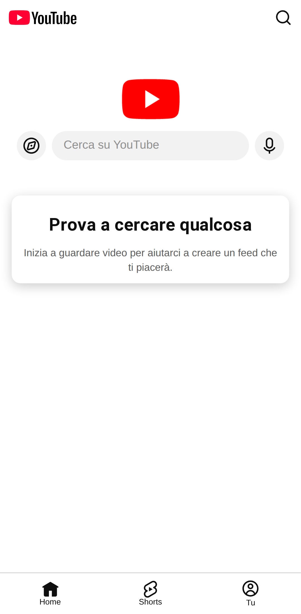
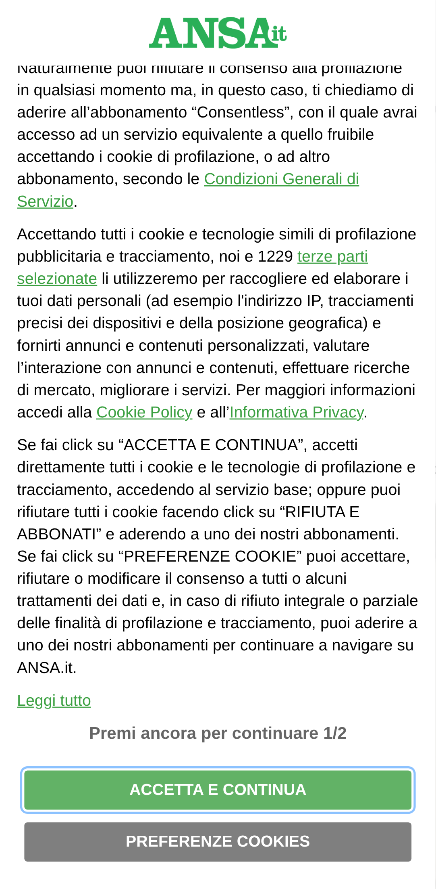
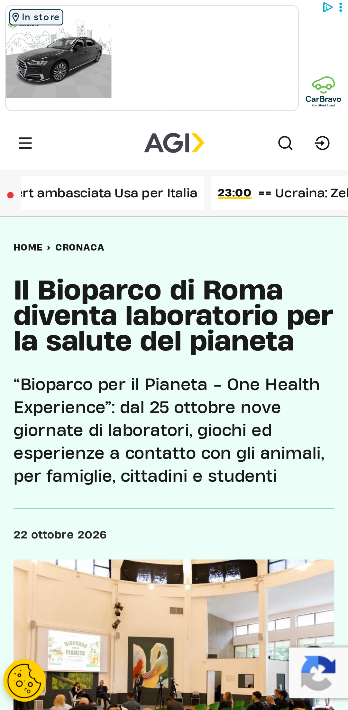
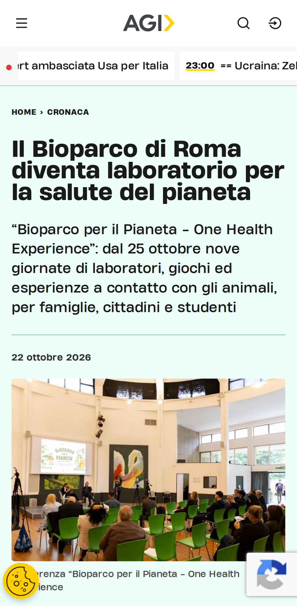
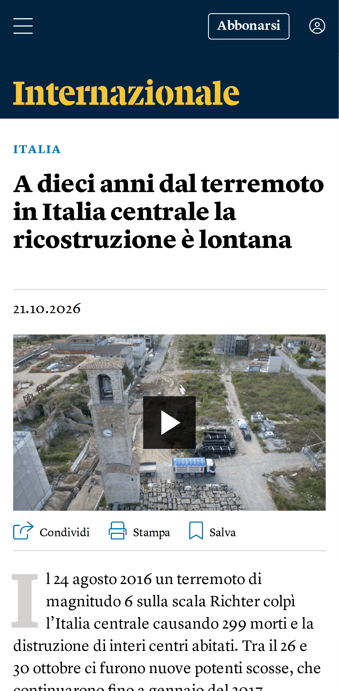

# Verifica dal vivo del blocco pubblicità

| Pagina | Richieste senza → con blocco | Bloccate | Riquadri pubblicitari visibili (senza → con) | Testo (caratteri, senza → con) | Errori JS con blocco |
|---|---|---|---|---|---|
| [YouTube home](https://m.youtube.com/) | 59 → 62 | 5 | 0 → 0 | 126 → 126 | 0 |
| [YouTube video](https://m.youtube.com/watch?v=kJQP7kiw5Fk) | 73 → 80 | 6 | 0 → 0 | 1532 → 1425 | 0 |
| [YouTube video 2](https://m.youtube.com/watch?v=JGwWNGJdvx8) | 74 → 75 | 6 | 0 → 0 | 1398 → 1421 | 0 |
| [ANSA home](https://www.ansa.it/) | 166 → 135 | 7 | 1 → 1 | 31625 → 31625 | 0 |
| [ANSA articolo](https://www.ansa.it/sito/notizie/topnews/2026/10/22/brasile-ordinato-larresto-di-ex-militare-uruguaiano-condannato-in-italia_fbfe281d-9f96-4592-9d6e-a9066e4912ac.html) | 3206 → 53 | 7 | 1 → 1 | 7894 → 7894 | 0 |
| [Fanpage home](https://www.fanpage.it/) | 1 → 1 | 0 | 0 → 0 | 196 → 194 | 0 |
| [Fanpage articolo](https://www.fanpage.it/sport/calcio/chivu-difende-pepo-martinez-so-che-il-portiere-viene-sempre-messo-in-prima-pagina-e-in-piazza-quando-fa-errori/) | 1 → 1 | 0 | 0 → 0 | 318 → 320 | 0 |
| [Open home](https://www.open.online/) | 367 → 261 | 13 | 15 → 0 | 21712 → 21704 | 1 |
| [Open articolo](https://www.open.online/2026/10/21/milano-studentessa-erasmus-violentata-fermato-31enne/) | 200 → 61 | 13 | 20 → 3 | 7613 → 6554 | 2 |
| [RaiNews home](https://www.rainews.it/) | 1 → 1 | 0 | 0 → 0 | 196 → 196 | 0 |
| [RaiNews articolo](https://www.rainews.it/video/2026/10/cisgiordania-due-italiani-tra-i-volontari-umanitari-arrestati-da-israele-macerollo-6509c0ae-b161-401a-9750-6940ede8173d.html) | 1 → 1 | 0 | 0 → 0 | 334 → 334 | 0 |
| [AGI home](https://www.agi.it/) | 187 → 113 | 5 | 5 → 0 | 14846 → 14139 | 0 |
| [AGI articolo](https://www.agi.it/cronaca/news/2026-10-22/roma-bioparco-laboratorio-salute-pianeta-39645676/) | 244 → 123 | 7 | 15 → 1 | 12196 → 10270 | 2 |
| [Internazionale home](https://www.internazionale.it/) | 214 → 149 | 9 | 20 → 1 | 11957 → 11902 | 0 |
| [Internazionale articolo](https://www.internazionale.it/video/2026/10/21/a-dieci-anni-dall-terremoto-in-italia-centrale-la-ricostruzione-e-lontana) | 127 → 77 | 10 | 9 → 3 | 1461 → 1437 | 0 |

## YouTube

- **YouTube home**: senza blocco {"title":"YouTube","textLength":126,"adFrames":0,"adBoxes":0,"playerResponse":false,"adPlacements":false,"playerAds":false,"adShowing":false,"video":{"time":0,"duration":0,"paused":true},"adRenderers":0}; con blocco {"title":"YouTube","textLength":126,"adFrames":0,"adBoxes":0,"playerResponse":false,"adPlacements":false,"playerAds":false,"adShowing":false,"video":{"time":0,"duration":0,"paused":true},"adRenderers":0}
- **YouTube video**: senza blocco {"title":"YouTube","textLength":1532,"adFrames":0,"adBoxes":0,"playerResponse":true,"adPlacements":false,"playerAds":false,"adShowing":false,"video":{"time":0,"duration":0,"paused":true},"adRenderers":0}; con blocco {"title":"YouTube","textLength":1425,"adFrames":0,"adBoxes":0,"playerResponse":true,"adPlacements":false,"playerAds":false,"adShowing":false,"video":{"time":0,"duration":0,"paused":true},"adRenderers":0}
- **YouTube video 2**: senza blocco {"title":"Ed Sheeran - Shape of You (Official Music Video) - YouTube","textLength":1398,"adFrames":0,"adBoxes":0,"playerResponse":true,"adPlacements":false,"playerAds":false,"adShowing":false,"video":{"time":0,"duration":0,"paused":true},"adRenderers":0}; con blocco {"title":"Ed Sheeran - Shape of You (Official Music Video) - YouTube","textLength":1421,"adFrames":0,"adBoxes":0,"playerResponse":true,"adPlacements":false,"playerAds":false,"adShowing":false,"video":{"time":0,"duration":0,"paused":true},"adRenderers":0}

## Domini bloccati più frequenti

- www.googletagmanager.com: 10
- m.youtube.com: 9
- securepubads.g.doubleclick.net: 8
- sb.scorecardresearch.com: 6
- googleads.g.doubleclick.net: 5
- cdn-gl.imrworldwide.com: 4
- cdn.taboola.com: 4
- static.doubleclick.net: 3
- ads.talkscreativity.com: 2
- visit-server.inmobi-choice.io: 2
- ads.pubmatic.com: 2
- link.rubiconproject.com: 2
- stats.open.online: 2
- api.cmp.inmobi.com: 2
- fundingchoicesmessages.google.com: 2
- ua.realtimely.io: 2
- www.googletagservices.com: 2
- assets.evolutionadv.it: 2
- secure-it.imrworldwide.com: 2
- static.internazionale.it: 2
- plausible.io: 2
- www.google-analytics.com: 2
- cdn.cxense.com: 2
- www.clarity.ms: 2
- connect.facebook.net: 2
- t.seedtag.com: 1
- www.ansa.it: 1
- d11otsap2ziep3.cloudfront.net: 1
- imasdk.googleapis.com: 1
- google-analytics.com: 1

## Errori JavaScript con il blocco

- Open home: `Uncaught TypeError: evopbjs.setConfig is not a function`
- Open articolo: `Uncaught TypeError: evopbjs.setConfig is not a function`
- Open articolo: `Uncaught ReferenceError: checkBannerFrame2 is not defined`
- AGI articolo: `TypeError: this.vjsPlayer.ads is not a function`
- AGI articolo: `TypeError: Cannot read properties of undefined (reading 'onPlayerVolumeChanged')`

## Foto

### YouTube home

| Senza blocco | Con blocco |
|---|---|
|  |  |

### YouTube video

| Senza blocco | Con blocco |
|---|---|
|  |  |

### YouTube video 2

| Senza blocco | Con blocco |
|---|---|
|  |  |

### ANSA home

| Senza blocco | Con blocco |
|---|---|
|  |  |

### ANSA articolo

| Senza blocco | Con blocco |
|---|---|
|  |  |

### Fanpage home

| Senza blocco | Con blocco |
|---|---|
|  |  |

### Fanpage articolo

| Senza blocco | Con blocco |
|---|---|
|  |  |

### Open home

| Senza blocco | Con blocco |
|---|---|
|  |  |

### Open articolo

| Senza blocco | Con blocco |
|---|---|
|  |  |

### RaiNews home

| Senza blocco | Con blocco |
|---|---|
|  |  |

### RaiNews articolo

| Senza blocco | Con blocco |
|---|---|
|  |  |

### AGI home

| Senza blocco | Con blocco |
|---|---|
|  |  |

### AGI articolo

| Senza blocco | Con blocco |
|---|---|
|  |  |

### Internazionale home

| Senza blocco | Con blocco |
|---|---|
|  |  |

### Internazionale articolo

| Senza blocco | Con blocco |
|---|---|
|  |  |

