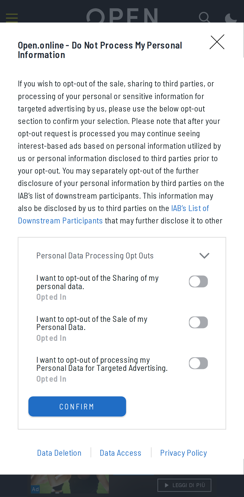
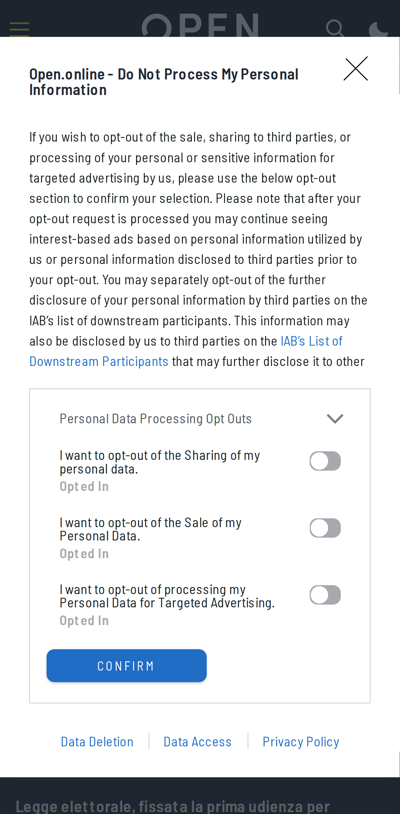
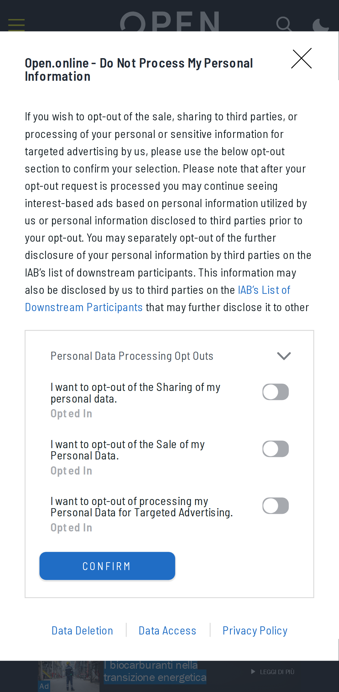
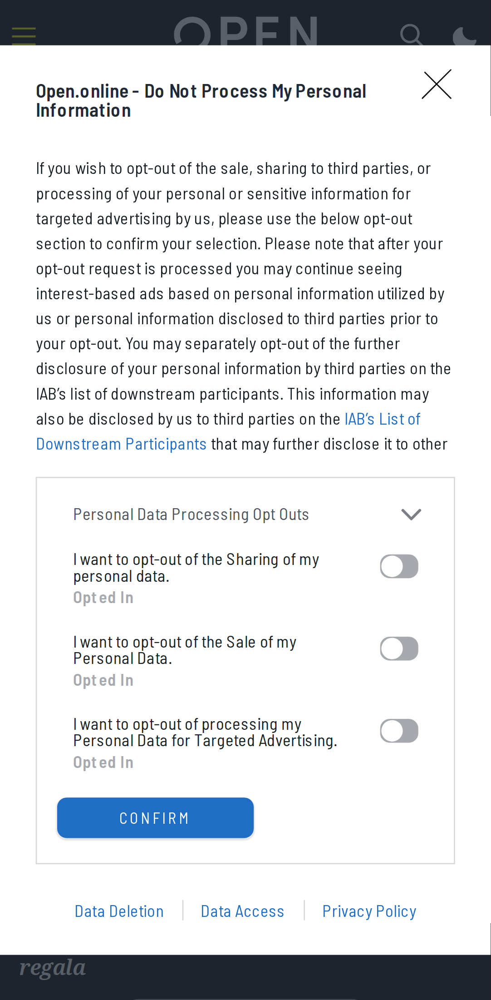
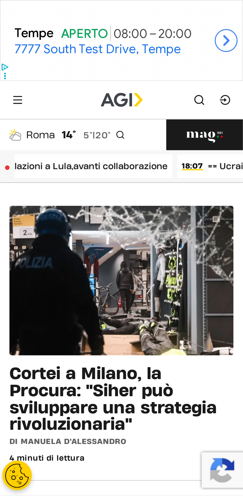
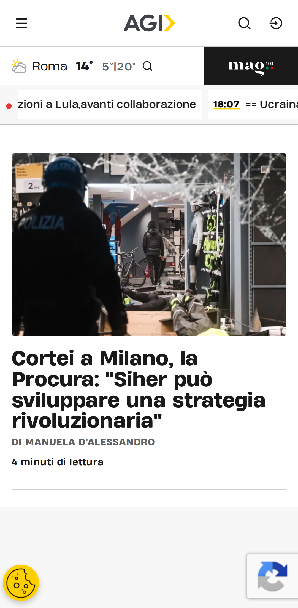
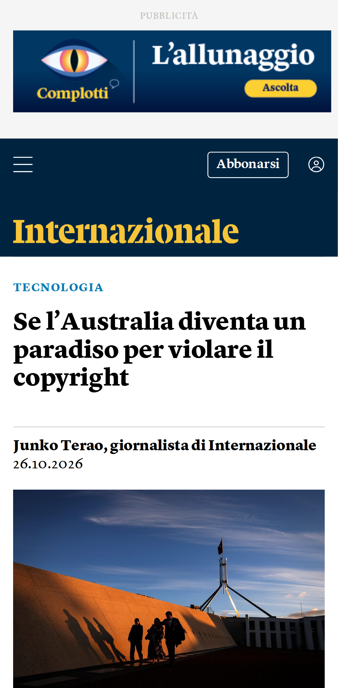

# Verifica dal vivo del blocco pubblicità

| Pagina | Richieste senza → con blocco | Bloccate | Riquadri pubblicitari visibili (senza → con) | Testo (caratteri, senza → con) | Errori JS con blocco |
|---|---|---|---|---|---|
| [YouTube home](https://m.youtube.com/) | 60 → 62 | 5 | 0 → 0 | 126 → 126 | 0 |
| [YouTube video](https://m.youtube.com/watch?v=kJQP7kiw5Fk) | 75 → 76 | 6 | 0 → 0 | 1554 → 1711 | 0 |
| [YouTube video 2](https://m.youtube.com/watch?v=JGwWNGJdvx8) | 73 → 76 | 6 | 0 → 0 | 1700 → 1710 | 0 |
| [ANSA home](https://www.ansa.it/) | 126 → 84 | 9 | 1 → 1 | 26779 → 26779 | 0 |
| [ANSA articolo](https://www.ansa.it/sito/notizie/topnews/2026/10/26/lo-spread-tra-btp-e-bund-chiude-in-forte-calo-a-112-punti_4e892336-c2df-45a9-bf7c-7679655e940a.html) | 1153 → 53 | 7 | 1 → 1 | 6854 → 6854 | 0 |
| [Fanpage home](https://www.fanpage.it/) | 1 → 1 | 0 | 0 → 0 | 196 → 194 | 0 |
| [Fanpage articolo](https://www.fanpage.it/attualita/garofano-torno-dalle-ferie-e-disse-che-avevo-sbagliato-tutto-lex-vice-del-ris-sullomicidio-di-chiara-poggi/) | 1 → 1 | 0 | 0 → 0 | 313 → 313 | 0 |
| [Open home](https://www.open.online/) | 371 → 262 | 13 | 16 → 0 | 20829 → 20821 | 1 |
| [Open articolo](https://www.open.online/2026/10/26/case-343-euro-metro-quadrato-paese-liguria-dove-comprare-appartamenti-gratis/) | 202 → 64 | 13 | 20 → 3 | 6620 → 5619 | 2 |
| [RaiNews home](https://www.rainews.it/) | 1 → 1 | 0 | 0 → 0 | 196 → 196 | 0 |
| [RaiNews articolo](https://www.rainews.it/articoli/2026/10/rimbalza-piazza-affari-129-dopo-la-vittoria-di-lula-crolla-la-borsa-brasiliana-15-e21cc82b-4c99-4020-8cd1-b7246cc87fbe.html) | 1 → 1 | 0 | 0 → 0 | 336 → 336 | 0 |
| [AGI home](https://www.agi.it/) | 192 → 114 | 6 | 5 → 0 | 15126 → 14318 | 1 |
| [AGI articolo](https://www.agi.it/estero/news/2026-10-26/elezioni-presidenziali-bulgaria-yotova-gyurov-39719835/) | 240 → 121 | 7 | 15 → 1 | 7636 → 5507 | 0 |
| [Internazionale home](https://www.internazionale.it/) | 191 → 152 | 9 | 16 → 1 | 11163 → 11119 | 0 |
| [Internazionale articolo](https://www.internazionale.it/notizie/junko-terao/2026/10/26/australia-copyright) | 153 → 102 | 9 | 9 → 3 | 1355 → 991 | 0 |

## YouTube

- **YouTube home**: senza blocco {"title":"YouTube","textLength":126,"adFrames":0,"adBoxes":0,"playerResponse":false,"adPlacements":false,"playerAds":false,"adShowing":false,"video":{"time":0,"duration":0,"paused":true},"adRenderers":0}; con blocco {"title":"YouTube","textLength":126,"adFrames":0,"adBoxes":0,"playerResponse":false,"adPlacements":false,"playerAds":false,"adShowing":false,"video":{"time":0,"duration":0,"paused":true},"adRenderers":0}
- **YouTube video**: senza blocco {"title":"Luis Fonsi - Despacito ft. Daddy Yankee - YouTube","textLength":1554,"adFrames":0,"adBoxes":0,"playerResponse":true,"adPlacements":false,"playerAds":false,"adShowing":false,"video":{"time":0,"duration":0,"paused":true},"adRenderers":0}; con blocco {"title":"YouTube","textLength":1711,"adFrames":0,"adBoxes":0,"playerResponse":true,"adPlacements":false,"playerAds":false,"adShowing":false,"video":{"time":0,"duration":0,"paused":true},"adRenderers":0}
- **YouTube video 2**: senza blocco {"title":"Ed Sheeran - Shape of You (Official Music Video) - YouTube","textLength":1700,"adFrames":0,"adBoxes":0,"playerResponse":true,"adPlacements":false,"playerAds":false,"adShowing":false,"video":{"time":0,"duration":0,"paused":true},"adRenderers":0}; con blocco {"title":"Ed Sheeran - Shape of You (Official Music Video) - YouTube","textLength":1710,"adFrames":0,"adBoxes":0,"playerResponse":true,"adPlacements":false,"playerAds":false,"adShowing":false,"video":{"time":0,"duration":0,"paused":true},"adRenderers":0}

## Domini bloccati più frequenti

- m.youtube.com: 9
- securepubads.g.doubleclick.net: 8
- www.googletagmanager.com: 8
- googleads.g.doubleclick.net: 6
- sb.scorecardresearch.com: 6
- static.doubleclick.net: 4
- cdn-gl.imrworldwide.com: 4
- cdn.taboola.com: 4
- ads.talkscreativity.com: 2
- www.youtube.com: 2
- stats.open.online: 2
- www.googletagservices.com: 2
- ua.realtimely.io: 2
- fundingchoicesmessages.google.com: 2
- visit-server.inmobi-choice.io: 2
- link.rubiconproject.com: 2
- ads.pubmatic.com: 2
- api.cmp.inmobi.com: 2
- assets.evolutionadv.it: 2
- secure-it.imrworldwide.com: 2
- static.internazionale.it: 2
- plausible.io: 2
- www.google-analytics.com: 2
- cdn.cxense.com: 2
- www.clarity.ms: 2
- connect.facebook.net: 2
- t.seedtag.com: 1
- www.ansa.it: 1
- privacyportal-eu.onetrust.com: 1
- d11otsap2ziep3.cloudfront.net: 1
- imasdk.googleapis.com: 1

## Errori JavaScript con il blocco

- Open home: `Uncaught TypeError: evopbjs.setConfig is not a function`
- Open articolo: `Uncaught TypeError: evopbjs.setConfig is not a function`
- Open articolo: `Uncaught ReferenceError: checkBannerFrame2 is not defined`
- AGI home: `Uncaught SyntaxError: Unexpected end of JSON input`

## Foto

### YouTube home

| Senza blocco | Con blocco |
|---|---|
|  |  |

### YouTube video

| Senza blocco | Con blocco |
|---|---|
|  |  |

### YouTube video 2

| Senza blocco | Con blocco |
|---|---|
|  |  |

### ANSA home

| Senza blocco | Con blocco |
|---|---|
|  |  |

### ANSA articolo

| Senza blocco | Con blocco |
|---|---|
|  |  |

### Fanpage home

| Senza blocco | Con blocco |
|---|---|
|  |  |

### Fanpage articolo

| Senza blocco | Con blocco |
|---|---|
|  |  |

### Open home

| Senza blocco | Con blocco |
|---|---|
|  |  |

### Open articolo

| Senza blocco | Con blocco |
|---|---|
|  |  |

### RaiNews home

| Senza blocco | Con blocco |
|---|---|
|  |  |

### RaiNews articolo

| Senza blocco | Con blocco |
|---|---|
|  |  |

### AGI home

| Senza blocco | Con blocco |
|---|---|
|  |  |

### AGI articolo

| Senza blocco | Con blocco |
|---|---|
|  |  |

### Internazionale home

| Senza blocco | Con blocco |
|---|---|
|  |  |

### Internazionale articolo

| Senza blocco | Con blocco |
|---|---|
|  |  |

