# Verifica dal vivo del blocco pubblicità

| Pagina | Richieste senza → con blocco | Bloccate | Riquadri pubblicitari visibili (senza → con) | Testo (caratteri, senza → con) | Errori JS con blocco |
|---|---|---|---|---|---|
| [YouTube home](https://m.youtube.com/) | 59 → 62 | 5 | 0 → 0 | 126 → 126 | 0 |
| [YouTube video](https://m.youtube.com/watch?v=kJQP7kiw5Fk) | 72 → 76 | 6 | 0 → 0 | 1485 → 1761 | 0 |
| [YouTube video 2](https://m.youtube.com/watch?v=JGwWNGJdvx8) | 74 → 77 | 6 | 0 → 0 | 1375 → 1415 | 0 |
| [ANSA home](https://www.ansa.it/) | 122 → 84 | 9 | 1 → 1 | 26550 → 26550 | 0 |
| [ANSA articolo](https://www.ansa.it/sito/notizie/topnews/2026/10/26/flavio-bolsonaro-la-polizia-mi-ha-tolto-il-passaporto_79d74835-a94c-4db4-afdc-d9eeb3b698a3.html) | 1092 → 53 | 7 | 1 → 1 | 7203 → 7203 | 0 |
| [Fanpage home](https://www.fanpage.it/) | 1 → 1 | 0 | 0 → 0 | 196 → 194 | 0 |
| [Fanpage articolo](https://www.fanpage.it/sport/calcio/harry-kane-e-il-vincitore-del-pallone-doro-2026-la-classifica-finale-e-i-premi-assegnati-per-categoria/) | 1 → 1 | 0 | 0 → 0 | 310 → 312 | 0 |
| [Open home](https://www.open.online/) | 366 → 257 | 13 | 16 → 0 | 19874 → 19866 | 1 |
| [Open articolo](https://www.open.online/2026/10/26/pallone-oro-2026-harry-kane-premi/) | 203 → 64 | 13 | 19 → 3 | 5251 → 4299 | 1 |
| [RaiNews home](https://www.rainews.it/) | 1 → 1 | 0 | 0 → 0 | 194 → 194 | 0 |
| [RaiNews articolo](https://www.rainews.it/rubriche/tg2post/video/2026/10/TG2-Post-del-26102026-61fc9ccf-e42b-4b89-a750-144e7d688a96.html) | 1 → 1 | 0 | 0 → 0 | 288 → 288 | 0 |
| [AGI home](https://www.agi.it/) | 163 → 112 | 5 | 3 → 0 | 15842 → 14774 | 0 |
| [AGI articolo](https://www.agi.it/estero/news/2026-10-30/elezioni-israele-incognite-partiti-39718328/) | 230 → 146 | 9 | 11 → 1 | 12415 → 10322 | 2 |
| [Internazionale home](https://www.internazionale.it/) | 155 → 152 | 9 | 17 → 1 | 12780 → 11169 | 0 |
| [Internazionale articolo](https://www.internazionale.it/notizie/junko-terao/2026/10/26/australia-copyright) | 154 → 102 | 9 | 9 → 3 | 1314 → 991 | 0 |

## YouTube

- **YouTube home**: senza blocco {"title":"YouTube","textLength":126,"adFrames":0,"adBoxes":0,"playerResponse":false,"adPlacements":false,"playerAds":false,"adShowing":false,"video":{"time":0,"duration":0,"paused":true},"adRenderers":0}; con blocco {"title":"YouTube","textLength":126,"adFrames":0,"adBoxes":0,"playerResponse":false,"adPlacements":false,"playerAds":false,"adShowing":false,"video":{"time":0,"duration":0,"paused":true},"adRenderers":0}
- **YouTube video**: senza blocco {"title":"YouTube","textLength":1485,"adFrames":0,"adBoxes":0,"playerResponse":true,"adPlacements":false,"playerAds":false,"adShowing":false,"video":{"time":0,"duration":0,"paused":true},"adRenderers":0}; con blocco {"title":"YouTube","textLength":1761,"adFrames":0,"adBoxes":0,"playerResponse":true,"adPlacements":false,"playerAds":false,"adShowing":false,"video":{"time":0,"duration":0,"paused":true},"adRenderers":0}
- **YouTube video 2**: senza blocco {"title":"YouTube","textLength":1375,"adFrames":0,"adBoxes":0,"playerResponse":true,"adPlacements":false,"playerAds":false,"adShowing":false,"video":{"time":0,"duration":0,"paused":true},"adRenderers":0}; con blocco {"title":"Ed Sheeran - Shape of You (Official Music Video) - YouTube","textLength":1415,"adFrames":0,"adBoxes":0,"playerResponse":true,"adPlacements":false,"playerAds":false,"adShowing":false,"video":{"time":0,"duration":0,"paused":true},"adRenderers":0}

## Domini bloccati più frequenti

- m.youtube.com: 9
- securepubads.g.doubleclick.net: 8
- www.googletagmanager.com: 8
- googleads.g.doubleclick.net: 6
- sb.scorecardresearch.com: 6
- static.doubleclick.net: 4
- cdn-gl.imrworldwide.com: 4
- cdn.taboola.com: 4
- ads.talkscreativity.com: 2
- www.youtube.com: 2
- visit-server.inmobi-choice.io: 2
- ads.pubmatic.com: 2
- link.rubiconproject.com: 2
- fundingchoicesmessages.google.com: 2
- stats.open.online: 2
- ua.realtimely.io: 2
- www.googletagservices.com: 2
- api.cmp.inmobi.com: 2
- assets.evolutionadv.it: 2
- secure-it.imrworldwide.com: 2
- syndication.x.com: 2
- static.internazionale.it: 2
- plausible.io: 2
- www.google-analytics.com: 2
- cdn.cxense.com: 2
- www.clarity.ms: 2
- connect.facebook.net: 2
- t.seedtag.com: 1
- www.ansa.it: 1
- d11otsap2ziep3.cloudfront.net: 1
- imasdk.googleapis.com: 1

## Errori JavaScript con il blocco

- Open home: `Uncaught TypeError: evopbjs.setConfig is not a function`
- Open articolo: `Uncaught TypeError: evopbjs.setConfig is not a function`
- AGI articolo: `TypeError: this.vjsPlayer.ads is not a function`
- AGI articolo: `TypeError: Cannot read properties of undefined (reading 'onPlayerVolumeChanged')`

## Foto

### YouTube home

| Senza blocco | Con blocco |
|---|---|
|  | 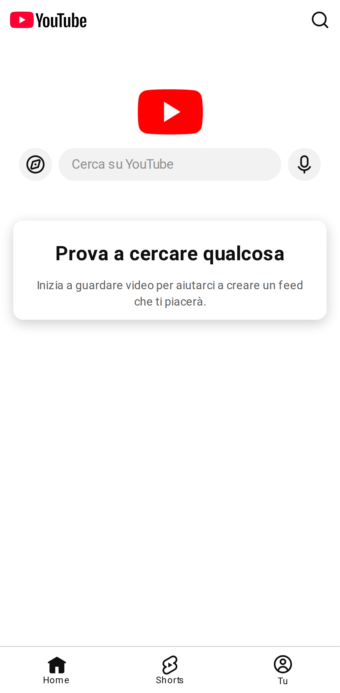 |

### YouTube video

| Senza blocco | Con blocco |
|---|---|
|  |  |

### YouTube video 2

| Senza blocco | Con blocco |
|---|---|
|  |  |

### ANSA home

| Senza blocco | Con blocco |
|---|---|
|  | 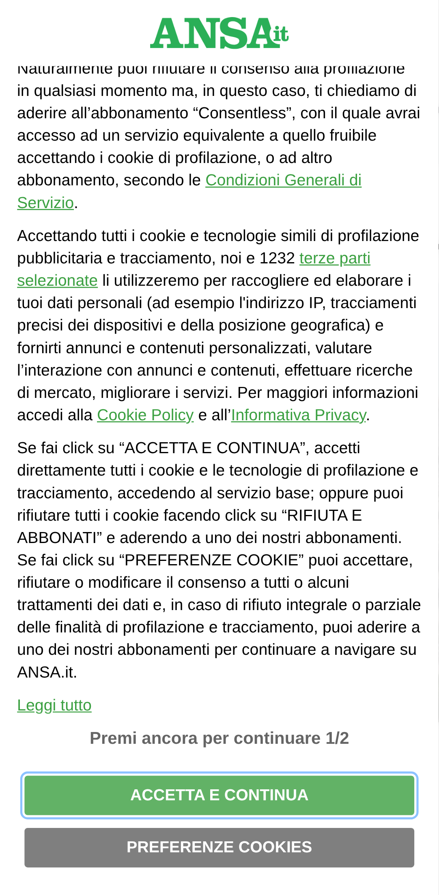 |

### ANSA articolo

| Senza blocco | Con blocco |
|---|---|
|  |  |

### Fanpage home

| Senza blocco | Con blocco |
|---|---|
|  |  |

### Fanpage articolo

| Senza blocco | Con blocco |
|---|---|
|  | 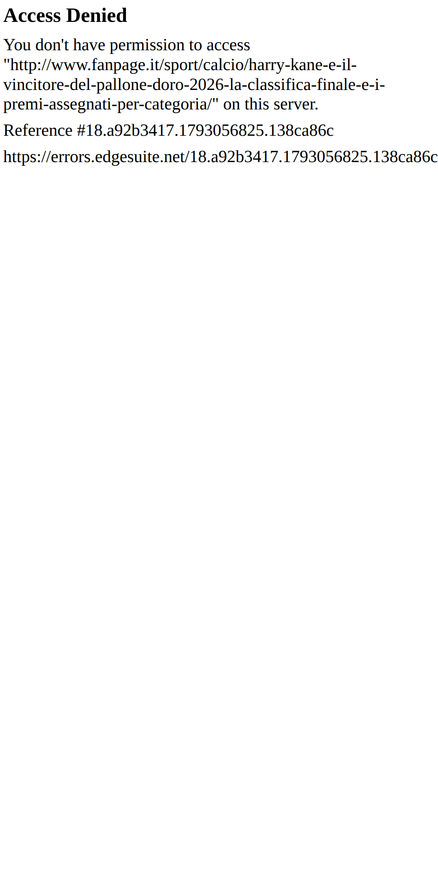 |

### Open home

| Senza blocco | Con blocco |
|---|---|
| 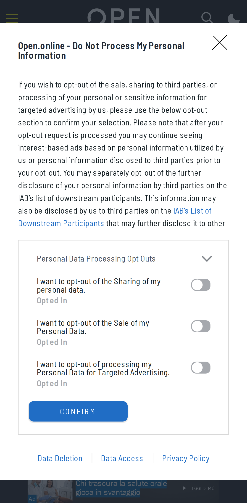 |  |

### Open articolo

| Senza blocco | Con blocco |
|---|---|
| 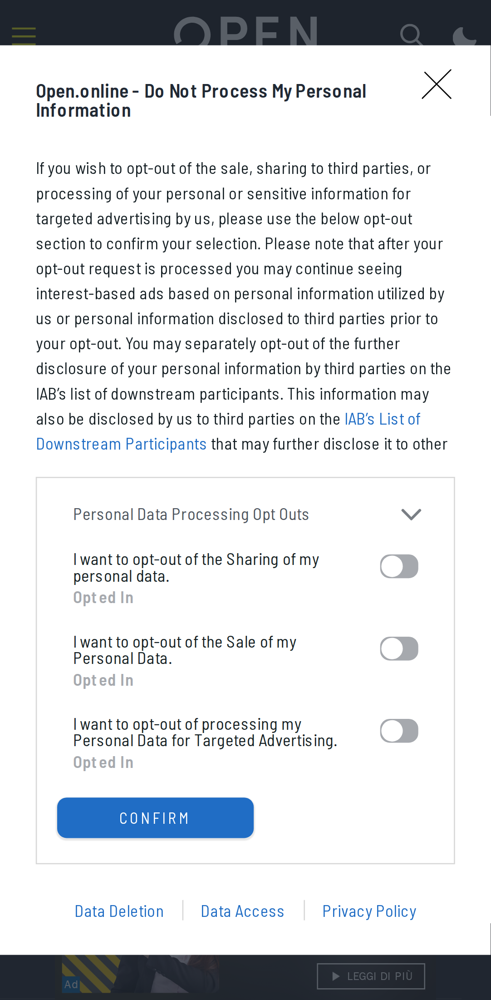 | 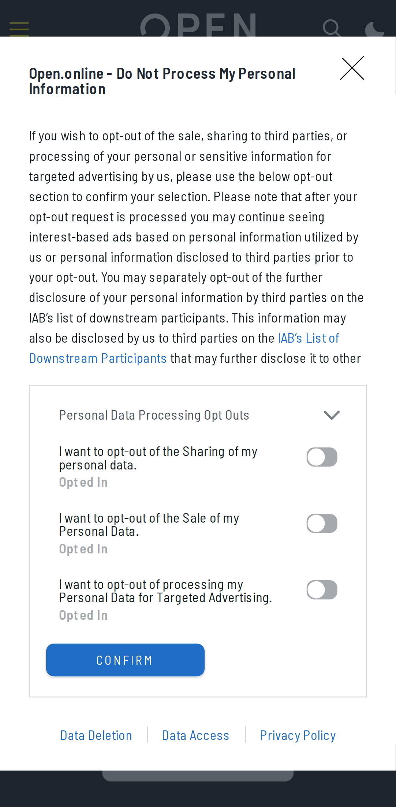 |

### RaiNews home

| Senza blocco | Con blocco |
|---|---|
|  | 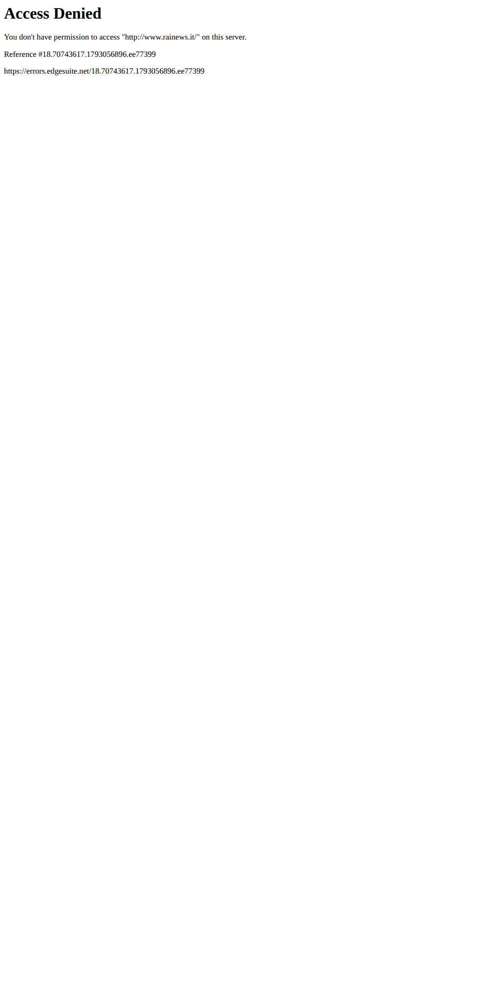 |

### RaiNews articolo

| Senza blocco | Con blocco |
|---|---|
| 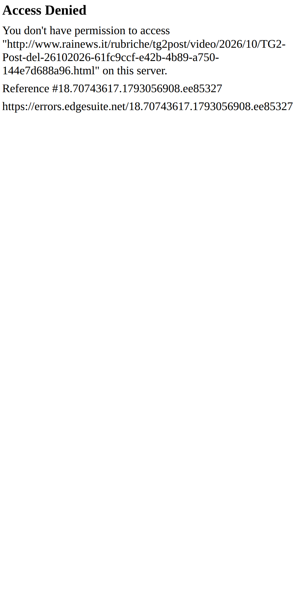 | 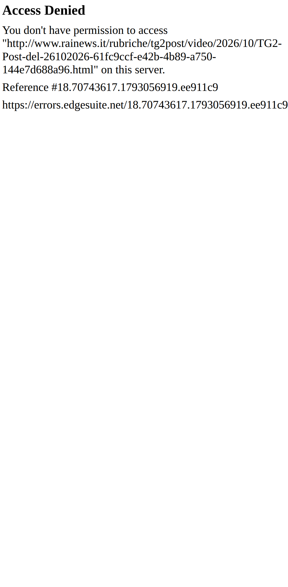 |

### AGI home

| Senza blocco | Con blocco |
|---|---|
| 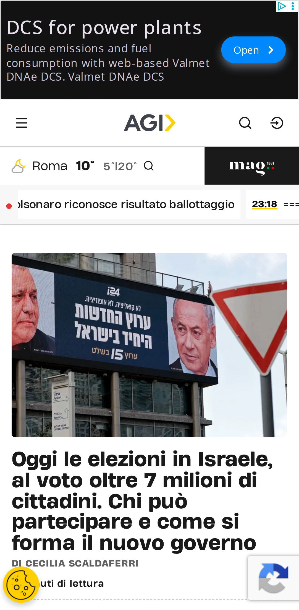 | 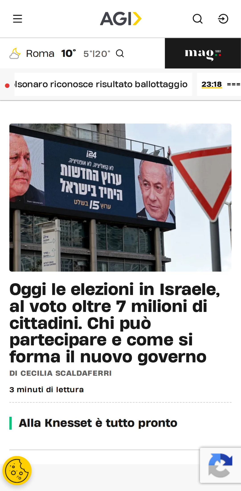 |

### AGI articolo

| Senza blocco | Con blocco |
|---|---|
|  | 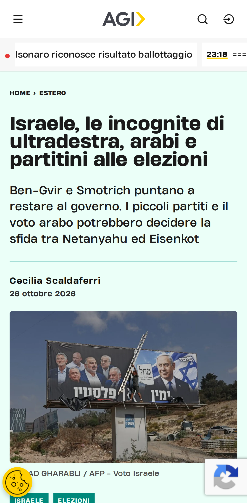 |

### Internazionale home

| Senza blocco | Con blocco |
|---|---|
| 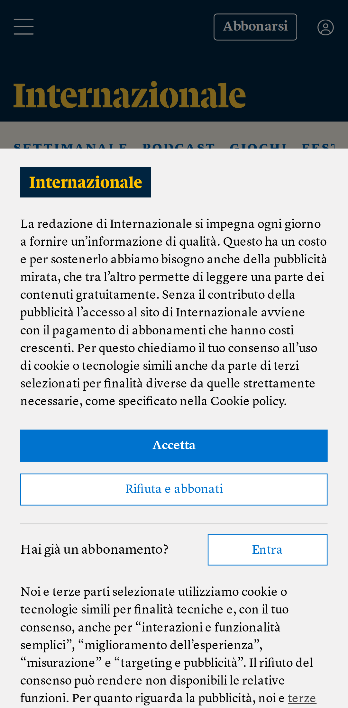 | 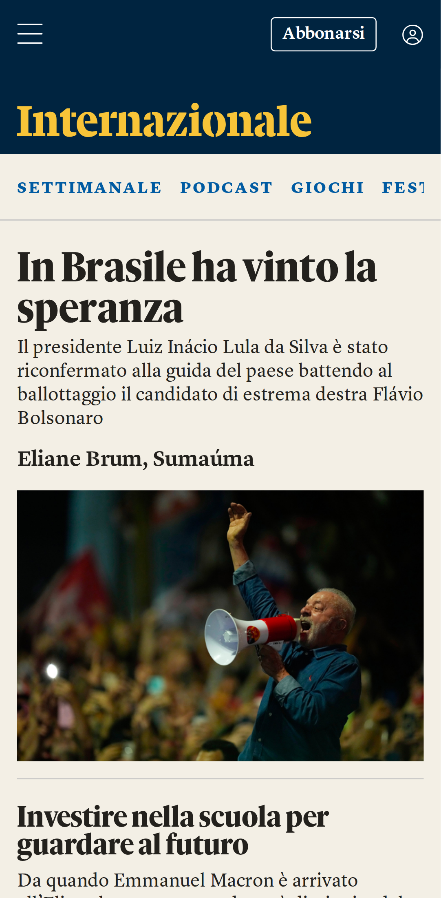 |

### Internazionale articolo

| Senza blocco | Con blocco |
|---|---|
| 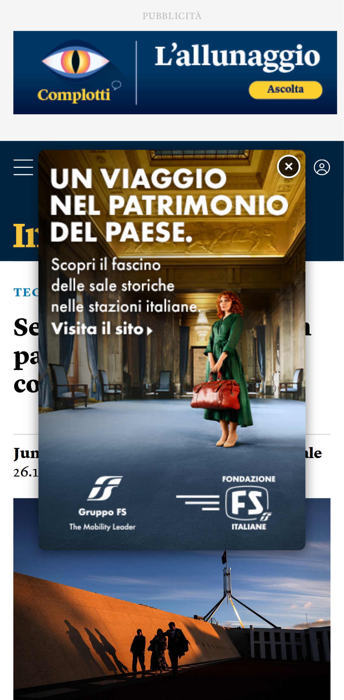 |  |

