# Verifica dal vivo del blocco pubblicità

| Pagina | Richieste senza → con blocco | Bloccate | Riquadri pubblicitari visibili (senza → con) | Testo (caratteri, senza → con) | Errori JS con blocco |
|---|---|---|---|---|---|
| [YouTube home](https://m.youtube.com/) | 59 → 63 | 5 | 0 → 0 | 126 → 126 | 0 |
| [YouTube video](https://m.youtube.com/watch?v=kJQP7kiw5Fk) | 72 → 78 | 6 | 0 → 0 | 1570 → 1765 | 0 |
| [YouTube video 2](https://m.youtube.com/watch?v=JGwWNGJdvx8) | 72 → 75 | 6 | 0 → 0 | 1391 → 1387 | 0 |
| [ANSA home](https://www.ansa.it/) | 149 → 120 | 7 | 1 → 1 | 29956 → 29965 | 0 |
| [ANSA articolo](https://www.ansa.it/sito/notizie/topnews/2026/10/22/da-oggi-diritto-alla-riparazione.-obblighi-per-produttori-tutele-per-consumatori_d741cf0d-dad0-4d72-b5cc-d4ea280a8c56.html) | 2345 → 46 | 7 | 1 → 1 | 9427 → 9427 | 0 |
| [Fanpage home](https://www.fanpage.it/) | 1 → 1 | 0 | 0 → 0 | 196 → 196 | 0 |
| [Fanpage articolo](https://www.fanpage.it/attualita/voli-a-rischio-in-7-aeroporti-italiani-rifornimenti-limitati-e-restrizioni-per-lo-sciopero-dei-camionisti/) | 1 → 1 | 0 | 0 → 0 | 312 → 312 | 0 |
| [Open home](https://www.open.online/) | 367 → 257 | 13 | 16 → 0 | 21070 → 21062 | 1 |
| [Open articolo](https://www.open.online/2026/10/22/annalisa-cuzzocrea-nuova-direttrice-huffpost-italia/) | 202 → 64 | 13 | 18 → 3 | 5365 → 4316 | 1 |
| [RaiNews home](https://www.rainews.it/) | 1 → 1 | 0 | 0 → 0 | 196 → 196 | 0 |
| [RaiNews articolo](https://www.rainews.it/articoli/2026/10/trump-vuole-ribattezzare-atlantico-oceano-americano-ma-google-dice-no-non-si-puo-fare-4674b4c2-3d24-4a24-a2a8-0aa26a2615a3.html) | 1 → 1 | 0 | 0 → 0 | 340 → 340 | 0 |
| [AGI home](https://www.agi.it/) | 149 → 113 | 5 | 1 → 0 | 15101 → 14482 | 0 |
| [AGI articolo](https://www.agi.it/cronaca/news/2026-10-22/cortei-nordio-nuovi-reati-39655286/) | 171 → 117 | 7 | 2 → 1 | 7372 → 5967 | 2 |
| [Internazionale home](https://www.internazionale.it/) | 188 → 148 | 9 | 16 → 1 | 11775 → 11731 | 0 |
| [Internazionale articolo](https://www.internazionale.it/oroscopo/2026/10/22/bilancia-22-28-ottobre-2026) | 120 → 67 | 10 | 7 → 1 | 782 → 771 | 0 |

## YouTube

- **YouTube home**: senza blocco {"title":"YouTube","textLength":126,"adFrames":0,"adBoxes":0,"playerResponse":false,"adPlacements":false,"playerAds":false,"adShowing":false,"video":{"time":0,"duration":0,"paused":true},"adRenderers":0}; con blocco {"title":"YouTube","textLength":126,"adFrames":0,"adBoxes":0,"playerResponse":false,"adPlacements":false,"playerAds":false,"adShowing":false,"video":{"time":0,"duration":0,"paused":true},"adRenderers":0}
- **YouTube video**: senza blocco {"title":"Luis Fonsi - Despacito ft. Daddy Yankee - YouTube","textLength":1570,"adFrames":0,"adBoxes":0,"playerResponse":true,"adPlacements":false,"playerAds":false,"adShowing":false,"video":{"time":0,"duration":0,"paused":true},"adRenderers":0}; con blocco {"title":"Luis Fonsi - Despacito ft. Daddy Yankee - YouTube","textLength":1765,"adFrames":0,"adBoxes":0,"playerResponse":true,"adPlacements":false,"playerAds":false,"adShowing":false,"video":{"time":0,"duration":0,"paused":true},"adRenderers":0}
- **YouTube video 2**: senza blocco {"title":"YouTube","textLength":1391,"adFrames":0,"adBoxes":0,"playerResponse":true,"adPlacements":false,"playerAds":false,"adShowing":false,"video":{"time":0,"duration":0,"paused":true},"adRenderers":0}; con blocco {"title":"Ed Sheeran - Shape of You (Official Music Video) - YouTube","textLength":1387,"adFrames":0,"adBoxes":0,"playerResponse":true,"adPlacements":false,"playerAds":false,"adShowing":false,"video":{"time":0,"duration":0,"paused":true},"adRenderers":0}

## Domini bloccati più frequenti

- www.googletagmanager.com: 10
- m.youtube.com: 9
- securepubads.g.doubleclick.net: 8
- sb.scorecardresearch.com: 6
- googleads.g.doubleclick.net: 5
- cdn-gl.imrworldwide.com: 4
- cdn.taboola.com: 4
- static.doubleclick.net: 3
- ads.talkscreativity.com: 2
- stats.open.online: 2
- fundingchoicesmessages.google.com: 2
- ua.realtimely.io: 2
- www.googletagservices.com: 2
- visit-server.inmobi-choice.io: 2
- link.rubiconproject.com: 2
- ads.pubmatic.com: 2
- api.cmp.inmobi.com: 2
- assets.evolutionadv.it: 2
- secure-it.imrworldwide.com: 2
- static.internazionale.it: 2
- plausible.io: 2
- www.google-analytics.com: 2
- cdn.cxense.com: 2
- www.clarity.ms: 2
- connect.facebook.net: 2
- t.seedtag.com: 1
- www.ansa.it: 1
- d11otsap2ziep3.cloudfront.net: 1
- imasdk.googleapis.com: 1
- a.teads.tv: 1

## Errori JavaScript con il blocco

- Open home: `Uncaught TypeError: evopbjs.setConfig is not a function`
- Open articolo: `Uncaught TypeError: evopbjs.setConfig is not a function`
- AGI articolo: `TypeError: this.vjsPlayer.ads is not a function`
- AGI articolo: `TypeError: Cannot read properties of undefined (reading 'onPlayerVolumeChanged')`

## Foto

### YouTube home

| Senza blocco | Con blocco |
|---|---|
|  |  |

### YouTube video

| Senza blocco | Con blocco |
|---|---|
|  |  |

### YouTube video 2

| Senza blocco | Con blocco |
|---|---|
|  |  |

### ANSA home

| Senza blocco | Con blocco |
|---|---|
|  |  |

### ANSA articolo

| Senza blocco | Con blocco |
|---|---|
|  | 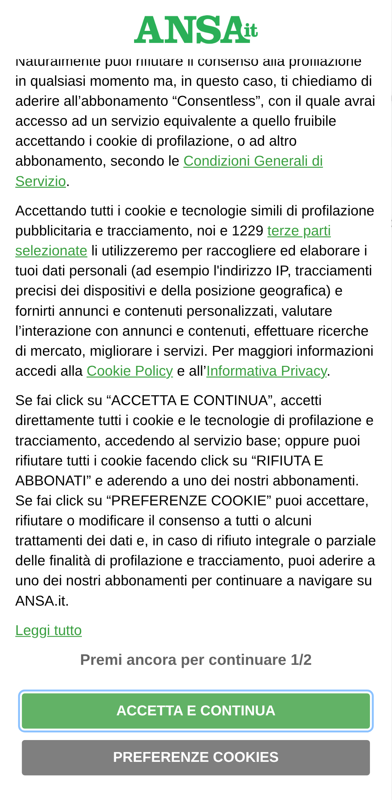 |

### Fanpage home

| Senza blocco | Con blocco |
|---|---|
|  |  |

### Fanpage articolo

| Senza blocco | Con blocco |
|---|---|
|  |  |

### Open home

| Senza blocco | Con blocco |
|---|---|
| 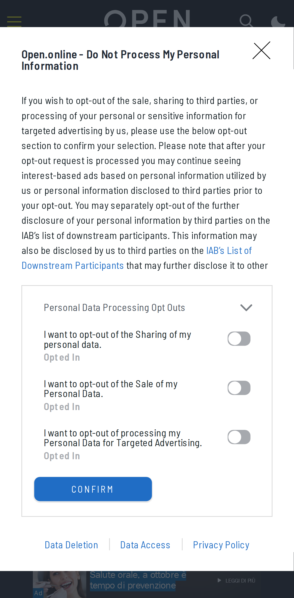 | 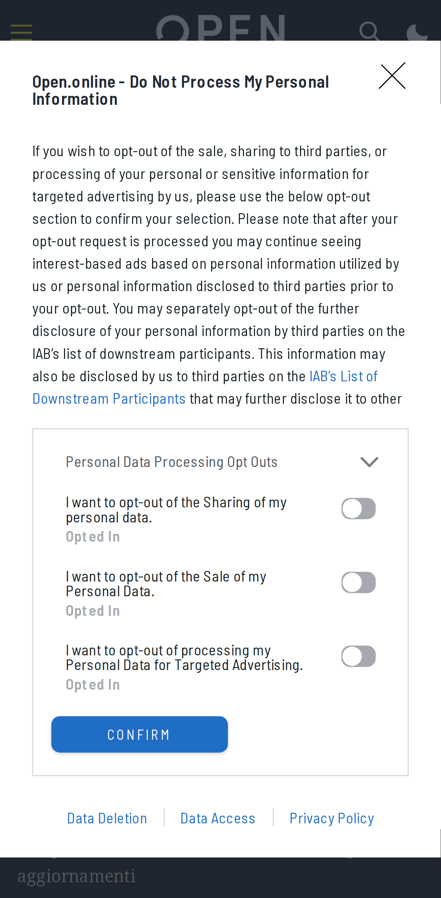 |

### Open articolo

| Senza blocco | Con blocco |
|---|---|
| 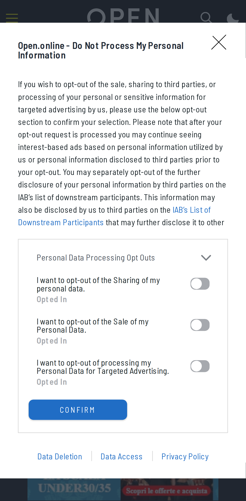 |  |

### RaiNews home

| Senza blocco | Con blocco |
|---|---|
|  |  |

### RaiNews articolo

| Senza blocco | Con blocco |
|---|---|
|  | 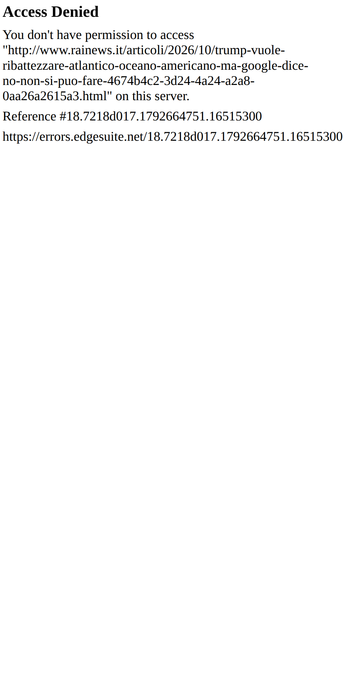 |

### AGI home

| Senza blocco | Con blocco |
|---|---|
| 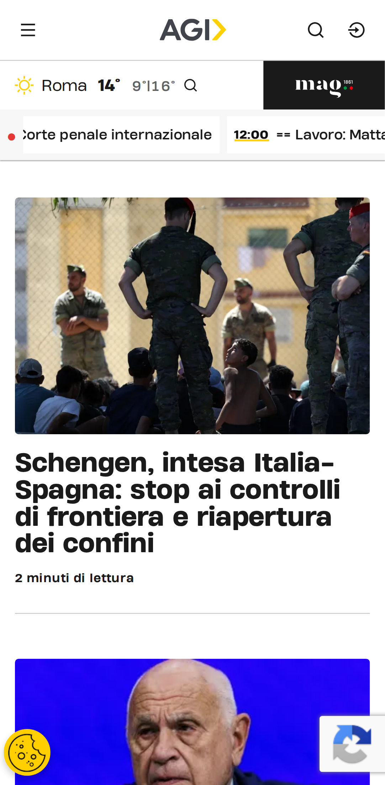 | 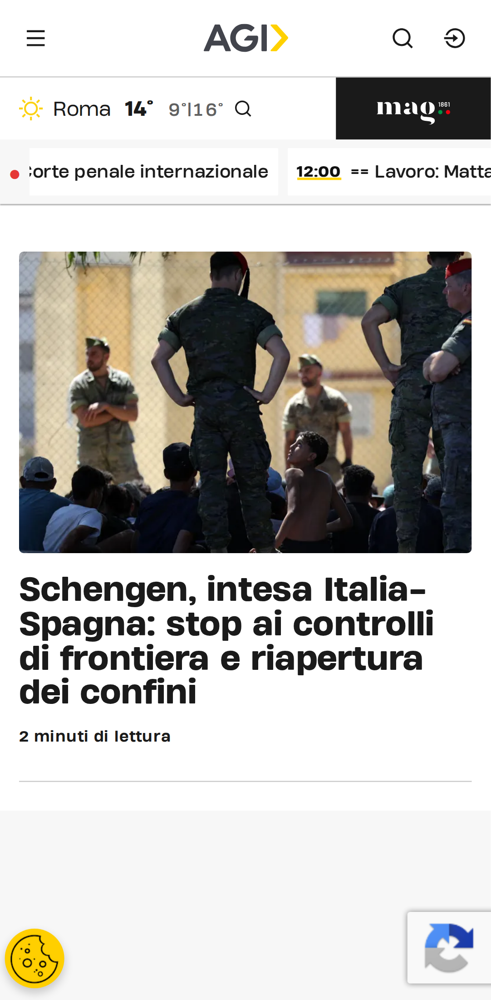 |

### AGI articolo

| Senza blocco | Con blocco |
|---|---|
|  | 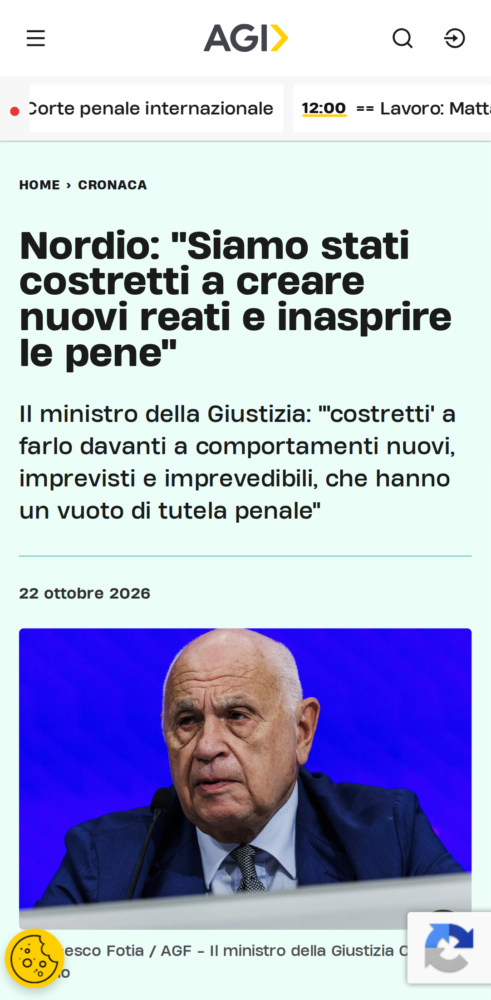 |

### Internazionale home

| Senza blocco | Con blocco |
|---|---|
| 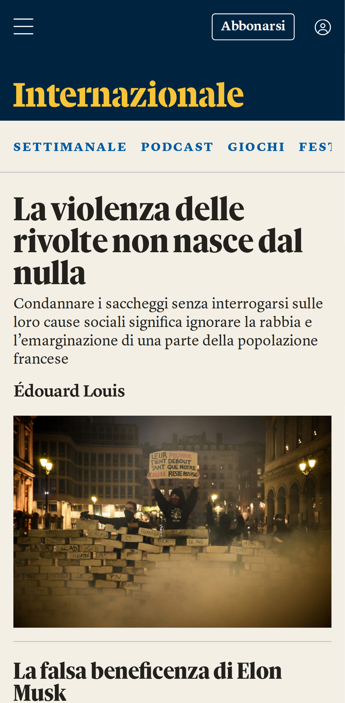 |  |

### Internazionale articolo

| Senza blocco | Con blocco |
|---|---|
| 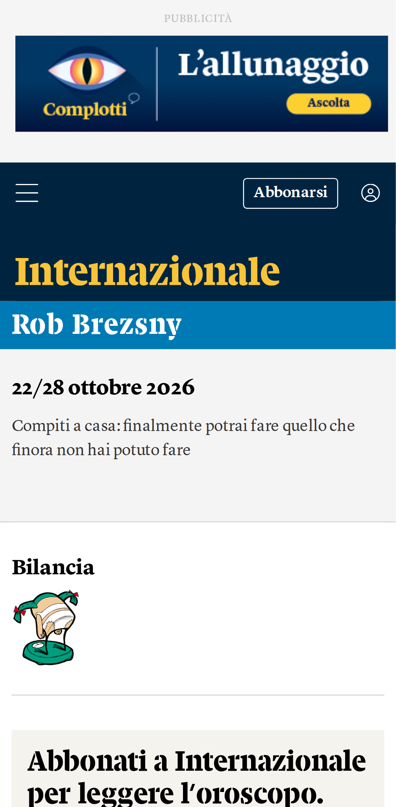 | 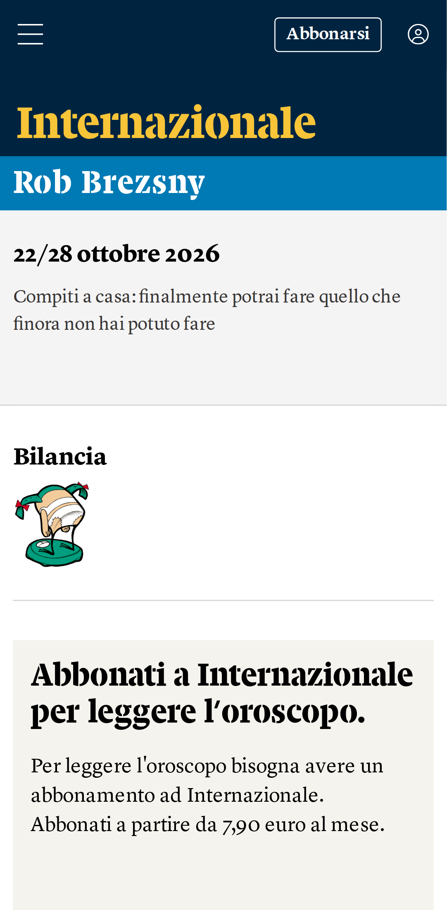 |

