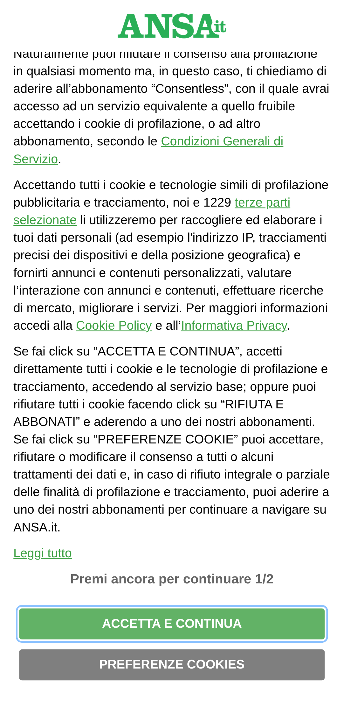
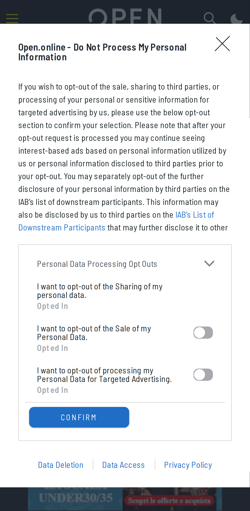
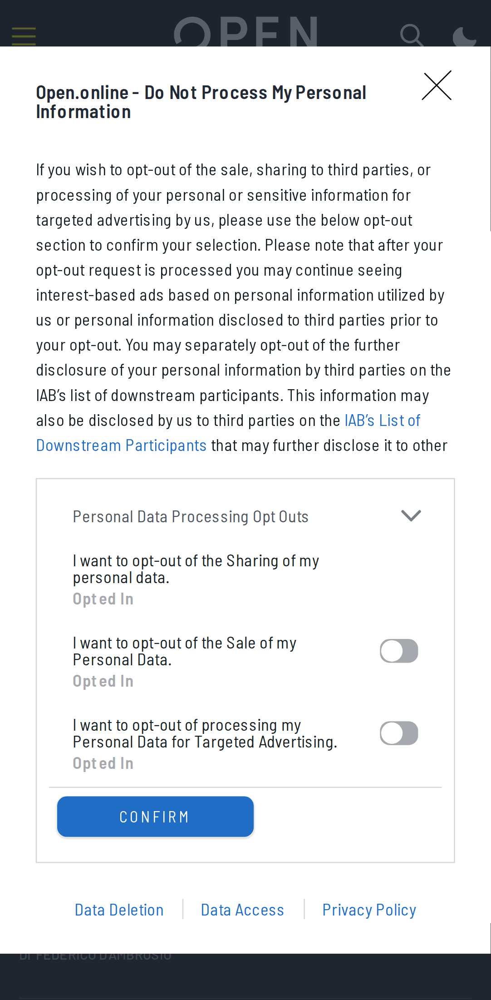
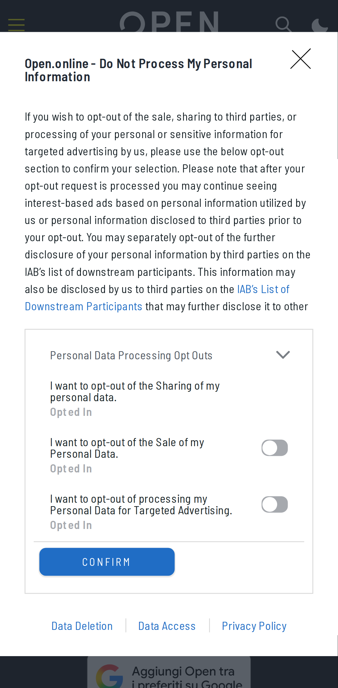
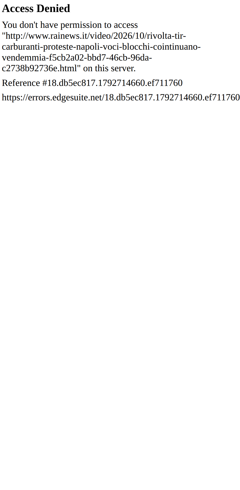
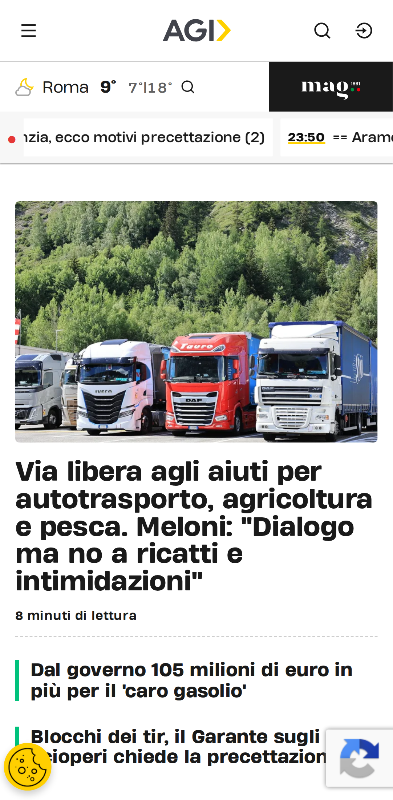
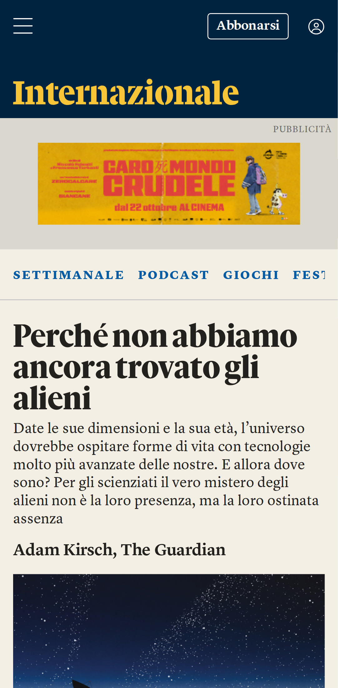
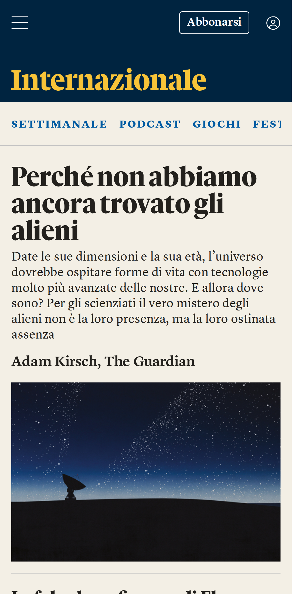
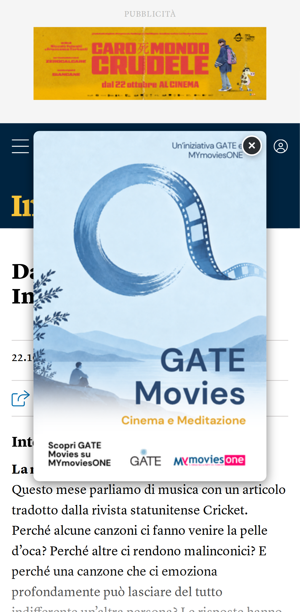
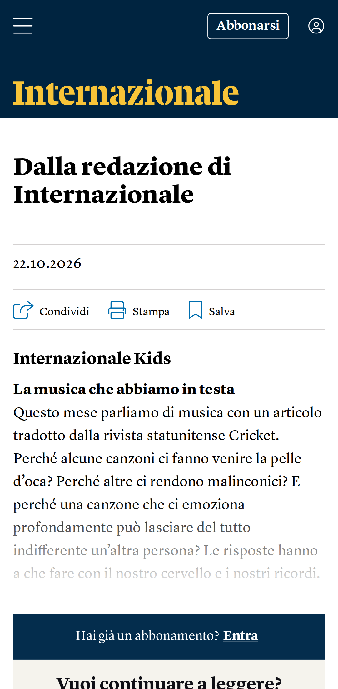

# Verifica dal vivo del blocco pubblicità

| Pagina | Richieste senza → con blocco | Bloccate | Riquadri pubblicitari visibili (senza → con) | Testo (caratteri, senza → con) | Errori JS con blocco |
|---|---|---|---|---|---|
| [YouTube home](https://m.youtube.com/) | 59 → 62 | 5 | 0 → 0 | 126 → 126 | 0 |
| [YouTube video](https://m.youtube.com/watch?v=kJQP7kiw5Fk) | 74 → 77 | 6 | 0 → 0 | 1538 → 1493 | 0 |
| [YouTube video 2](https://m.youtube.com/watch?v=JGwWNGJdvx8) | 74 → 76 | 6 | 0 → 0 | 1417 → 1372 | 0 |
| [ANSA home](https://www.ansa.it/) | 221 → 184 | 8 | 1 → 1 | 30317 → 30317 | 0 |
| [ANSA articolo](https://www.ansa.it/sito/notizie/topnews/2026/10/22/autotrasporto-il-garante-degli-scioperi-chiede-la-precettazione_e4b778ed-6e52-4fe4-803f-9327d22b604c.html) | 3093 → 53 | 7 | 1 → 1 | 7525 → 7525 | 0 |
| [Fanpage home](https://www.fanpage.it/) | 1 → 1 | 0 | 0 → 0 | 192 → 196 | 0 |
| [Fanpage articolo](https://www.fanpage.it/sport/motori/motogp-gp-australia-2026-orari-su-tv8-e-sky-e-dove-vedere-phillip-island-in-diretta-tv-e-streaming/) | 1 → 1 | 0 | 0 → 0 | 306 → 306 | 0 |
| [Open home](https://www.open.online/) | 369 → 263 | 13 | 15 → 0 | 21815 → 21807 | 1 |
| [Open articolo](https://www.open.online/2026/10/22/guadagna-milione-sterline-vendendo-carte-pokemon-asta/) | 11 → 63 | 13 | 0 → 3 | 0 → 5143 | 2 |
| [RaiNews home](https://www.rainews.it/) | 1 → 1 | 0 | 0 → 0 | 194 → 194 | 0 |
| [RaiNews articolo](https://www.rainews.it/video/2026/10/rivolta-tir-carburanti-proteste-napoli-voci-blocchi-cointinuano-vendemmia-f5cb2a02-bbd7-46cb-96da-c2738b92736e.html) | 1 → 1 | 0 | 0 → 0 | 325 → 325 | 0 |
| [AGI home](https://www.agi.it/) | 169 → 112 | 5 | 3 → 0 | 15234 → 14617 | 0 |
| [AGI articolo](https://www.agi.it/cronaca/news/2026-10-22/ia-salute-terapie-neurologia-39661197/) | 204 → 122 | 7 | 11 → 1 | 8938 → 6786 | 2 |
| [Internazionale home](https://www.internazionale.it/) | 206 → 149 | 9 | 20 → 1 | 11271 → 11216 | 0 |
| [Internazionale articolo](https://www.internazionale.it/notizie/2026/10/22/articoli-online-1688) | 167 → 103 | 10 | 8 → 3 | 1179 → 840 | 0 |

## YouTube

- **YouTube home**: senza blocco {"title":"YouTube","textLength":126,"adFrames":0,"adBoxes":0,"playerResponse":false,"adPlacements":false,"playerAds":false,"adShowing":false,"video":{"time":0,"duration":0,"paused":true},"adRenderers":0}; con blocco {"title":"YouTube","textLength":126,"adFrames":0,"adBoxes":0,"playerResponse":false,"adPlacements":false,"playerAds":false,"adShowing":false,"video":{"time":0,"duration":0,"paused":true},"adRenderers":0}
- **YouTube video**: senza blocco {"title":"Luis Fonsi - Despacito ft. Daddy Yankee - YouTube","textLength":1538,"adFrames":0,"adBoxes":0,"playerResponse":true,"adPlacements":false,"playerAds":false,"adShowing":false,"video":{"time":0,"duration":0,"paused":true},"adRenderers":0}; con blocco {"title":"Luis Fonsi - Despacito ft. Daddy Yankee - YouTube","textLength":1493,"adFrames":0,"adBoxes":0,"playerResponse":true,"adPlacements":false,"playerAds":false,"adShowing":false,"video":{"time":0,"duration":0,"paused":true},"adRenderers":0}
- **YouTube video 2**: senza blocco {"title":"Ed Sheeran - Shape of You (Official Music Video) - YouTube","textLength":1417,"adFrames":0,"adBoxes":0,"playerResponse":true,"adPlacements":false,"playerAds":false,"adShowing":false,"video":{"time":0,"duration":0,"paused":true},"adRenderers":0}; con blocco {"title":"YouTube","textLength":1372,"adFrames":0,"adBoxes":0,"playerResponse":true,"adPlacements":false,"playerAds":false,"adShowing":false,"video":{"time":0,"duration":0,"paused":true},"adRenderers":0}

## Domini bloccati più frequenti

- www.googletagmanager.com: 10
- m.youtube.com: 9
- securepubads.g.doubleclick.net: 8
- sb.scorecardresearch.com: 6
- googleads.g.doubleclick.net: 5
- cdn-gl.imrworldwide.com: 4
- cdn.taboola.com: 4
- static.doubleclick.net: 3
- ads.talkscreativity.com: 2
- fundingchoicesmessages.google.com: 2
- stats.open.online: 2
- ua.realtimely.io: 2
- www.googletagservices.com: 2
- visit-server.inmobi-choice.io: 2
- link.rubiconproject.com: 2
- ads.pubmatic.com: 2
- api.cmp.inmobi.com: 2
- assets.evolutionadv.it: 2
- secure-it.imrworldwide.com: 2
- static.internazionale.it: 2
- plausible.io: 2
- www.google-analytics.com: 2
- cdn.cxense.com: 2
- www.clarity.ms: 2
- connect.facebook.net: 2
- www.datadoghq-browser-agent.com: 1
- t.seedtag.com: 1
- www.ansa.it: 1
- d11otsap2ziep3.cloudfront.net: 1
- imasdk.googleapis.com: 1
- google-analytics.com: 1

## Errori JavaScript con il blocco

- Open home: `Uncaught TypeError: evopbjs.setConfig is not a function`
- Open articolo: `Uncaught ReferenceError: checkBannerFrame2 is not defined`
- Open articolo: `Uncaught TypeError: evopbjs.setConfig is not a function`
- AGI articolo: `TypeError: this.vjsPlayer.ads is not a function`
- AGI articolo: `TypeError: Cannot read properties of undefined (reading 'onPlayerVolumeChanged')`

## Foto

### YouTube home

| Senza blocco | Con blocco |
|---|---|
|  |  |

### YouTube video

| Senza blocco | Con blocco |
|---|---|
|  |  |

### YouTube video 2

| Senza blocco | Con blocco |
|---|---|
|  |  |

### ANSA home

| Senza blocco | Con blocco |
|---|---|
|  |  |

### ANSA articolo

| Senza blocco | Con blocco |
|---|---|
|  |  |

### Fanpage home

| Senza blocco | Con blocco |
|---|---|
|  |  |

### Fanpage articolo

| Senza blocco | Con blocco |
|---|---|
|  |  |

### Open home

| Senza blocco | Con blocco |
|---|---|
|  |  |

### Open articolo

| Senza blocco | Con blocco |
|---|---|
|  |  |

### RaiNews home

| Senza blocco | Con blocco |
|---|---|
|  |  |

### RaiNews articolo

| Senza blocco | Con blocco |
|---|---|
|  |  |

### AGI home

| Senza blocco | Con blocco |
|---|---|
|  |  |

### AGI articolo

| Senza blocco | Con blocco |
|---|---|
|  |  |

### Internazionale home

| Senza blocco | Con blocco |
|---|---|
|  |  |

### Internazionale articolo

| Senza blocco | Con blocco |
|---|---|
|  |  |

