# Verifica dal vivo del blocco pubblicità

| Pagina | Richieste senza → con blocco | Bloccate | Riquadri pubblicitari visibili (senza → con) | Testo (caratteri, senza → con) | Errori JS con blocco |
|---|---|---|---|---|---|
| [YouTube home](https://m.youtube.com/) | 60 → 62 | 5 | 0 → 0 | 126 → 126 | 0 |
| [YouTube video](https://m.youtube.com/watch?v=kJQP7kiw5Fk) | 73 → 75 | 6 | 0 → 0 | 1763 → 1559 | 0 |
| [YouTube video 2](https://m.youtube.com/watch?v=JGwWNGJdvx8) | 73 → 76 | 6 | 0 → 0 | 1657 → 1363 | 0 |
| [ANSA home](https://www.ansa.it/) | 251 → 209 | 14 | 1 → 1 | 30177 → 30177 | 0 |
| [ANSA articolo](https://www.ansa.it/sito/notizie/topnews/2026/10/23/armatori-siciliani-pesca-interventi-insufficienti-via-a-sciopero-fiscale_5a616e28-ebd0-490b-9217-08113392bfa5.html) | 2453 → 46 | 7 | 1 → 1 | 8729 → 8729 | 0 |
| [Fanpage home](https://www.fanpage.it/) | 1 → 1 | 0 | 0 → 0 | 194 → 196 | 0 |
| [Fanpage articolo](https://www.fanpage.it/politica/manovra-governo-accelera-e-studia-taglio-irpef-in-due-fasi-dal-2027-aliquota-al-33-fino-a-55mila-euro/) | 1 → 1 | 0 | 0 → 0 | 307 → 307 | 0 |
| [Open home](https://www.open.online/) | 465 → 279 | 14 | 14 → 0 | 22352 → 22352 | 1 |
| [Open articolo](https://www.open.online/2026/10/23/scontri-milano-stop-passamontagna-mantova/) | 365 → 71 | 14 | 18 → 3 | 4913 → 3912 | 2 |
| [RaiNews home](https://www.rainews.it/) | 1 → 1 | 0 | 0 → 0 | 194 → 194 | 0 |
| [RaiNews articolo](https://www.rainews.it/video/2026/10/-fedez-denunciato-da-4-fan-abbiamo-chiesto-un-selfie-ci-hanno-picchiato-ad9100f1-9ab2-496a-9323-9139e3913ead.html) | 1 → 1 | 0 | 0 → 0 | 321 → 321 | 0 |
| [AGI home](https://www.agi.it/) | 165 → 113 | 5 | 1 → 0 | 15137 → 14402 | 0 |
| [AGI articolo](https://www.agi.it/estero/news/2026-10-23/parigi-cortei-negozi-blindati-39669793/) | 198 → 96 | 5 | 16 → 0 | 9558 → 7828 | 0 |
| [Internazionale home](https://www.internazionale.it/) | 190 → 150 | 9 | 16 → 1 | 11213 → 11169 | 0 |
| [Internazionale articolo](https://www.internazionale.it/notizie/francesca-gnetti/2026/10/23/guida-elezioni-israele) | 154 → 102 | 9 | 9 → 3 | 1522 → 1121 | 0 |

## YouTube

- **YouTube home**: senza blocco {"title":"YouTube","textLength":126,"adFrames":0,"adBoxes":0,"playerResponse":false,"adPlacements":false,"playerAds":false,"adShowing":false,"video":{"time":0,"duration":0,"paused":true},"adRenderers":0}; con blocco {"title":"YouTube","textLength":126,"adFrames":0,"adBoxes":0,"playerResponse":false,"adPlacements":false,"playerAds":false,"adShowing":false,"video":{"time":0,"duration":0,"paused":true},"adRenderers":0}
- **YouTube video**: senza blocco {"title":"YouTube","textLength":1763,"adFrames":0,"adBoxes":0,"playerResponse":true,"adPlacements":false,"playerAds":false,"adShowing":false,"video":{"time":0,"duration":0,"paused":true},"adRenderers":0}; con blocco {"title":"YouTube","textLength":1559,"adFrames":0,"adBoxes":0,"playerResponse":true,"adPlacements":false,"playerAds":false,"adShowing":false,"video":{"time":0,"duration":0,"paused":true},"adRenderers":0}
- **YouTube video 2**: senza blocco {"title":"YouTube","textLength":1657,"adFrames":0,"adBoxes":0,"playerResponse":true,"adPlacements":false,"playerAds":false,"adShowing":false,"video":{"time":0,"duration":0,"paused":true},"adRenderers":0}; con blocco {"title":"Ed Sheeran - Shape of You (Official Music Video) - YouTube","textLength":1363,"adFrames":0,"adBoxes":0,"playerResponse":true,"adPlacements":false,"playerAds":false,"adShowing":false,"video":{"time":0,"duration":0,"paused":true},"adRenderers":0}

## Domini bloccati più frequenti

- www.googletagmanager.com: 10
- m.youtube.com: 9
- securepubads.g.doubleclick.net: 8
- sb.scorecardresearch.com: 6
- arclight.vimeo.com: 6
- googleads.g.doubleclick.net: 5
- cdn-gl.imrworldwide.com: 4
- api.cmp.inmobi.com: 4
- cdn.taboola.com: 4
- static.doubleclick.net: 3
- ads.talkscreativity.com: 2
- fundingchoicesmessages.google.com: 2
- stats.open.online: 2
- www.googletagservices.com: 2
- ua.realtimely.io: 2
- visit-server.inmobi-choice.io: 2
- link.rubiconproject.com: 2
- ads.pubmatic.com: 2
- assets.evolutionadv.it: 2
- secure-it.imrworldwide.com: 2
- static.internazionale.it: 2
- plausible.io: 2
- www.google-analytics.com: 2
- cdn.cxense.com: 2
- www.clarity.ms: 2
- connect.facebook.net: 2
- www.datadoghq-browser-agent.com: 1
- t.seedtag.com: 1
- www.ansa.it: 1

## Errori JavaScript con il blocco

- Open home: `Uncaught TypeError: evopbjs.setConfig is not a function`
- Open articolo: `Uncaught ReferenceError: checkBannerFrame2 is not defined`
- Open articolo: `Uncaught TypeError: evopbjs.setConfig is not a function`

## Foto

### YouTube home

| Senza blocco | Con blocco |
|---|---|
|  |  |

### YouTube video

| Senza blocco | Con blocco |
|---|---|
|  |  |

### YouTube video 2

| Senza blocco | Con blocco |
|---|---|
|  |  |

### ANSA home

| Senza blocco | Con blocco |
|---|---|
|  | 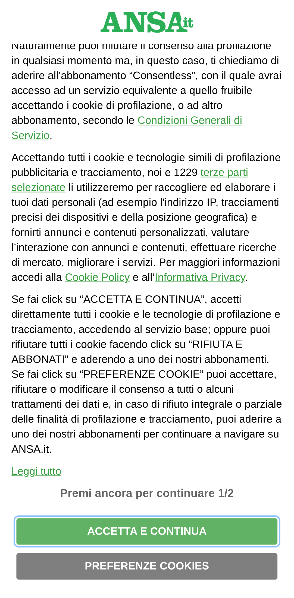 |

### ANSA articolo

| Senza blocco | Con blocco |
|---|---|
|  |  |

### Fanpage home

| Senza blocco | Con blocco |
|---|---|
|  |  |

### Fanpage articolo

| Senza blocco | Con blocco |
|---|---|
| 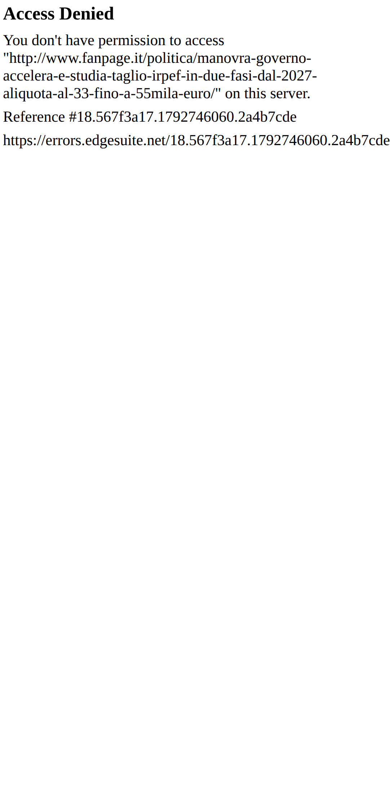 | 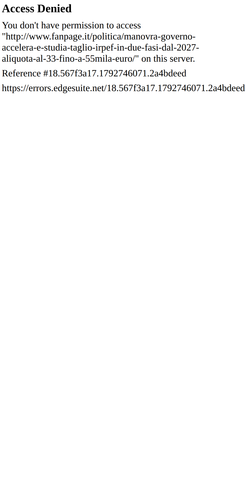 |

### Open home

| Senza blocco | Con blocco |
|---|---|
| 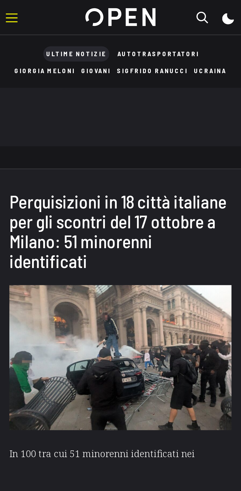 | 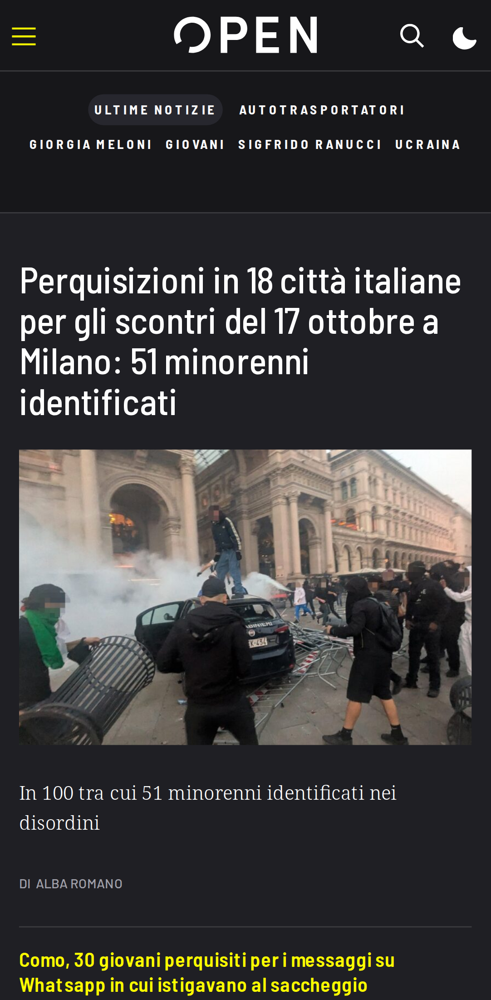 |

### Open articolo

| Senza blocco | Con blocco |
|---|---|
| 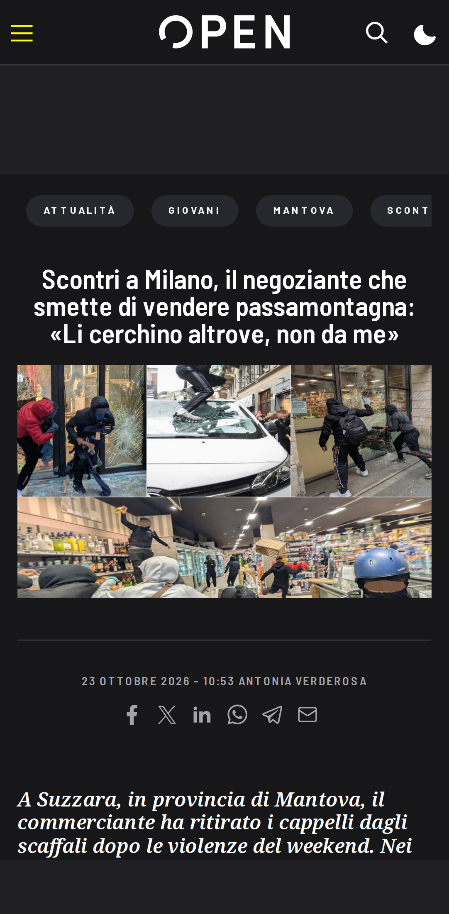 | 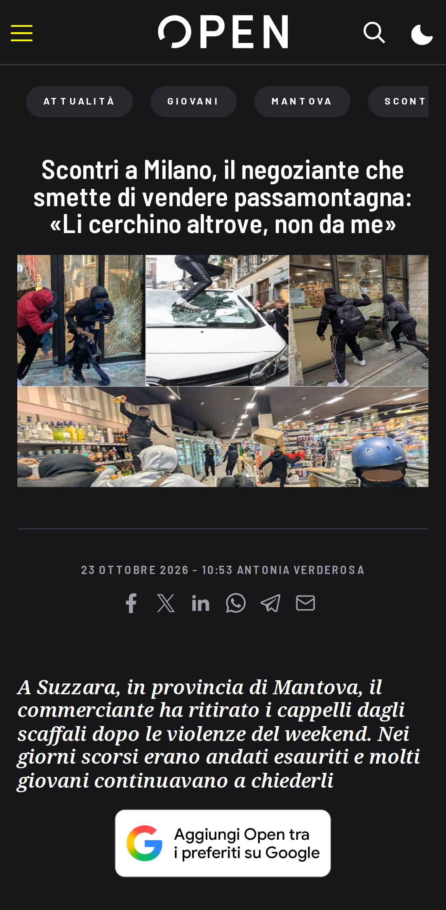 |

### RaiNews home

| Senza blocco | Con blocco |
|---|---|
|  |  |

### RaiNews articolo

| Senza blocco | Con blocco |
|---|---|
|  |  |

### AGI home

| Senza blocco | Con blocco |
|---|---|
| 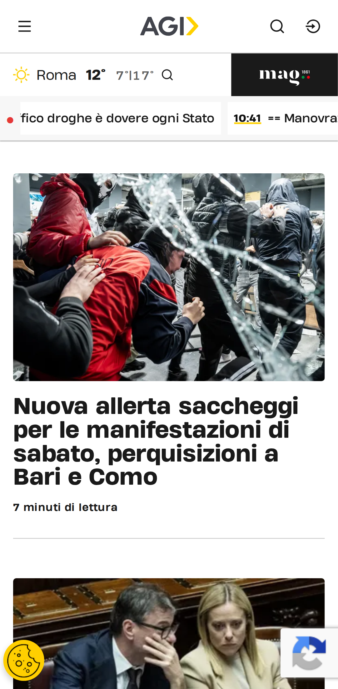 | 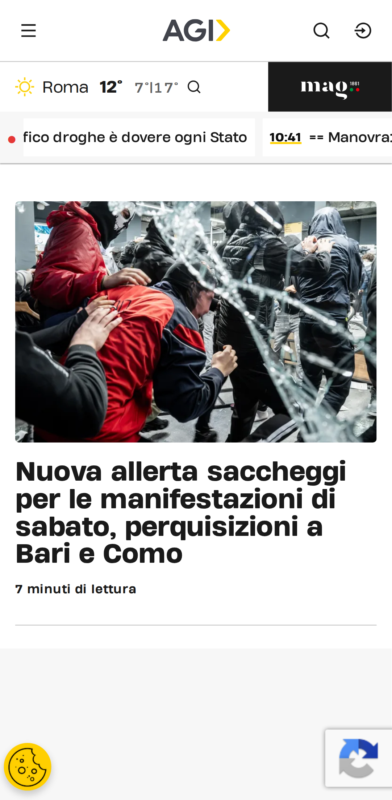 |

### AGI articolo

| Senza blocco | Con blocco |
|---|---|
|  | 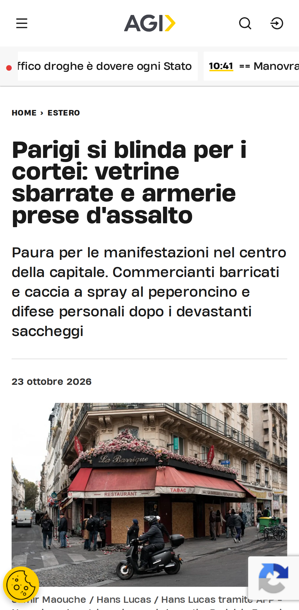 |

### Internazionale home

| Senza blocco | Con blocco |
|---|---|
|  |  |

### Internazionale articolo

| Senza blocco | Con blocco |
|---|---|
| 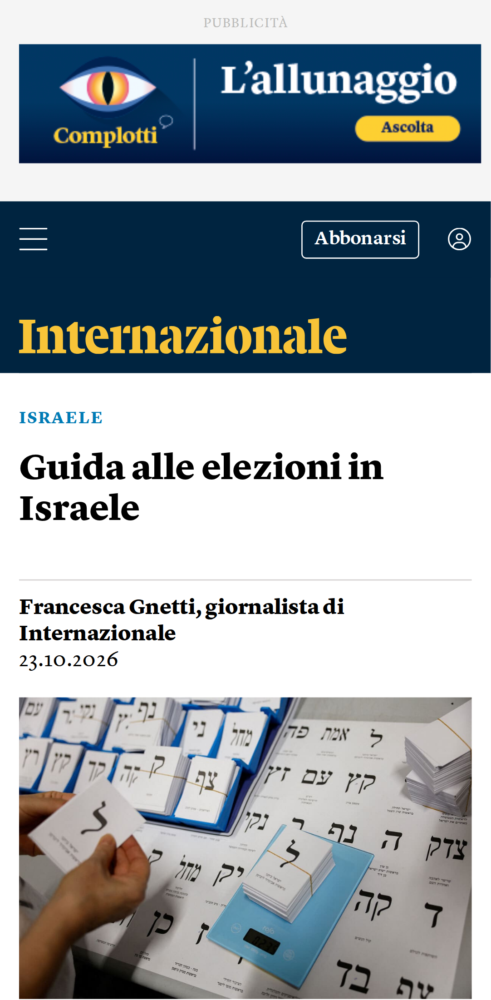 | 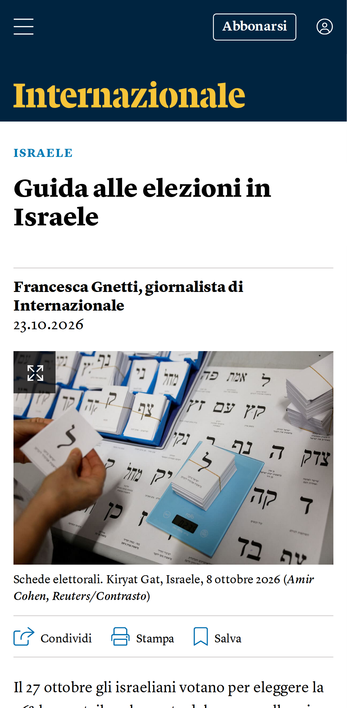 |

