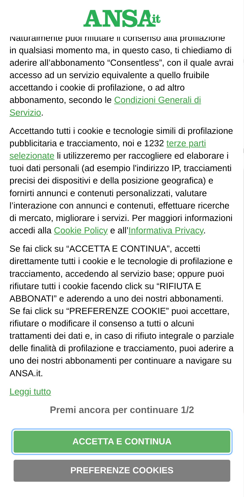
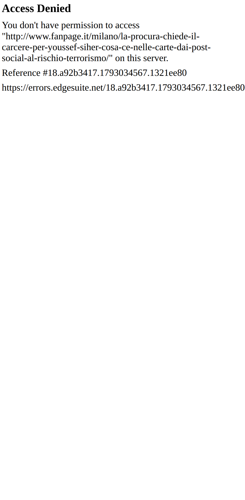
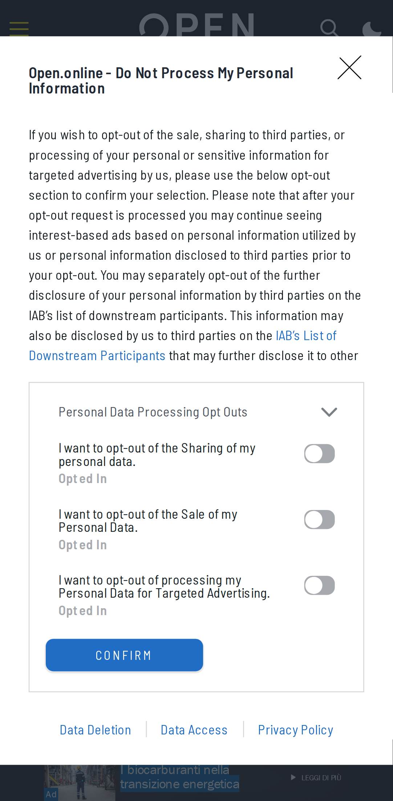
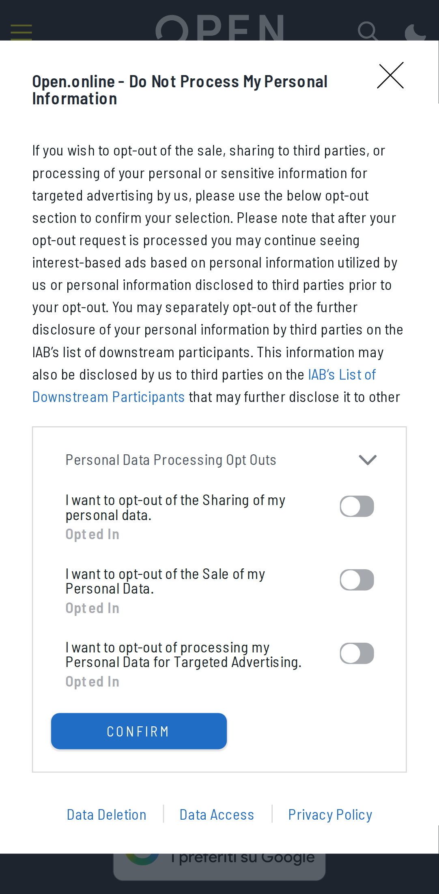
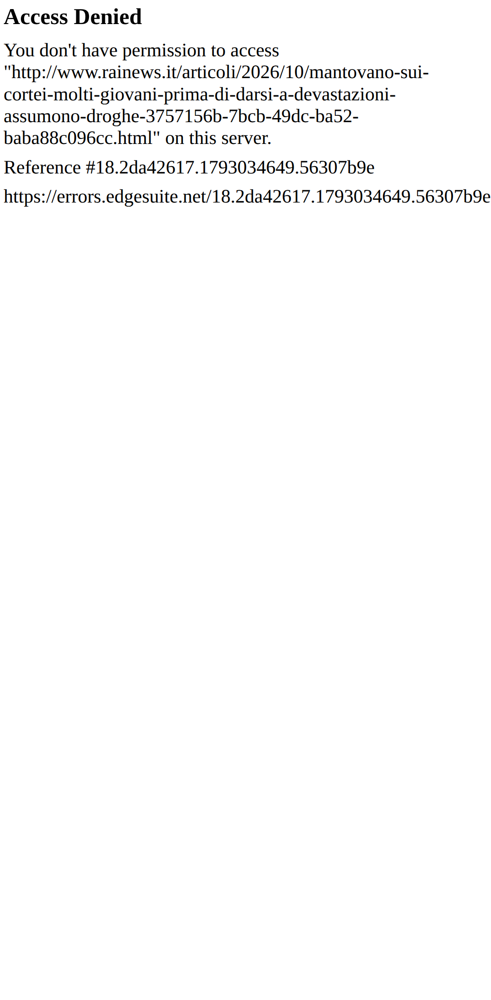
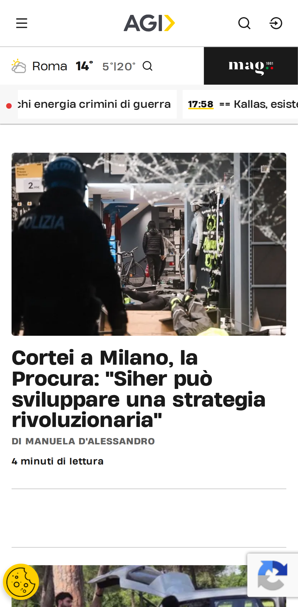
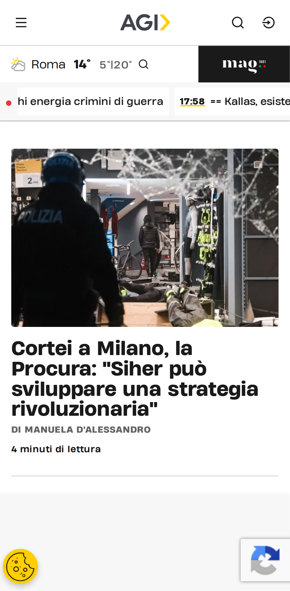
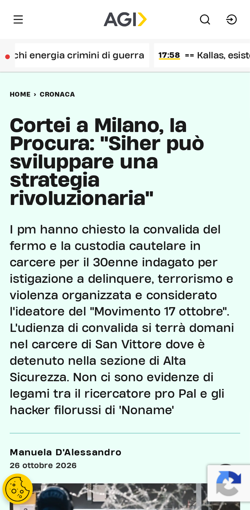
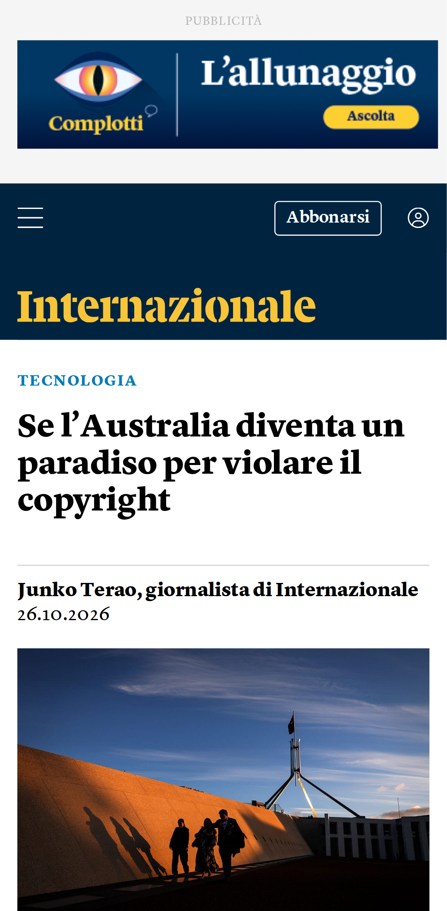
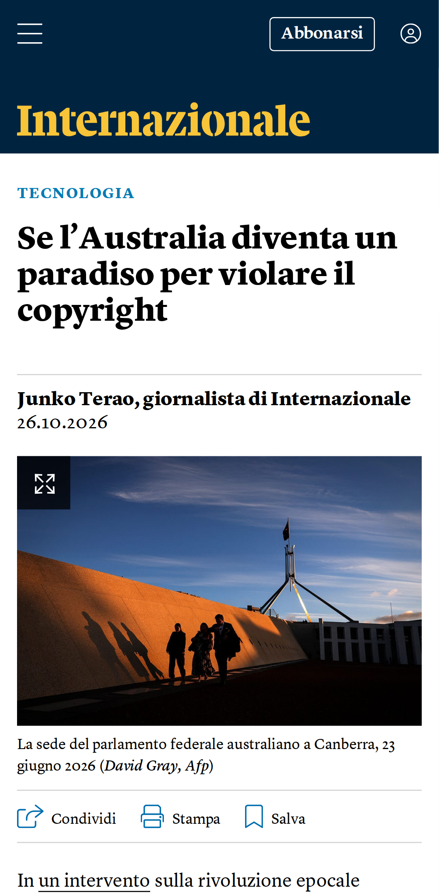

# Verifica dal vivo del blocco pubblicità

| Pagina | Richieste senza → con blocco | Bloccate | Riquadri pubblicitari visibili (senza → con) | Testo (caratteri, senza → con) | Errori JS con blocco |
|---|---|---|---|---|---|
| [YouTube home](https://m.youtube.com/) | 59 → 62 | 5 | 0 → 0 | 126 → 126 | 0 |
| [YouTube video](https://m.youtube.com/watch?v=kJQP7kiw5Fk) | 13 → 13 | 0 | 0 → 0 | 341 → 341 | 1 |
| [YouTube video 2](https://m.youtube.com/watch?v=JGwWNGJdvx8) | 13 → 13 | 0 | 0 → 0 | 341 → 341 | 1 |
| [ANSA home](https://www.ansa.it/) | 124 → 84 | 9 | 1 → 1 | 26335 → 26335 | 0 |
| [ANSA articolo](https://www.ansa.it/sito/notizie/topnews/2026/10/26/borsa-milano-chiude-in-rialzo-dell129_9a40b5a1-978a-4272-bd33-a136a1f44bb4.html) | 2314 → 53 | 7 | 1 → 1 | 6689 → 6689 | 0 |
| [Fanpage home](https://www.fanpage.it/) | 1 → 1 | 0 | 0 → 0 | 196 → 194 | 0 |
| [Fanpage articolo](https://www.fanpage.it/milano/la-procura-chiede-il-carcere-per-youssef-siher-cosa-ce-nelle-carte-dai-post-social-al-rischio-terrorismo/) | 1 → 1 | 0 | 0 → 0 | 308 → 308 | 0 |
| [Open home](https://www.open.online/) | 371 → 262 | 13 | 16 → 0 | 20832 → 20824 | 1 |
| [Open articolo](https://www.open.online/2026/10/26/papa-leone-viaggio-sudamerica-medici/) | 201 → 64 | 13 | 20 → 3 | 6426 → 5549 | 2 |
| [RaiNews home](https://www.rainews.it/) | 1 → 1 | 0 | 0 → 0 | 196 → 196 | 0 |
| [RaiNews articolo](https://www.rainews.it/articoli/2026/10/mantovano-sui-cortei-molti-giovani-prima-di-darsi-a-devastazioni-assumono-droghe-3757156b-7bcb-49dc-ba52-baba88c096cc.html) | 1 → 1 | 0 | 0 → 0 | 335 → 335 | 0 |
| [AGI home](https://www.agi.it/) | 150 → 114 | 6 | 1 → 0 | 15096 → 14526 | 1 |
| [AGI articolo](https://www.agi.it/cronaca/news/2026-10-26/cortei-milano-siher-procura-chiede-carcere-39715079/) | 213 → 123 | 8 | 11 → 1 | 9610 → 7230 | 3 |
| [Internazionale home](https://www.internazionale.it/) | 192 → 152 | 9 | 16 → 1 | 11180 → 11136 | 0 |
| [Internazionale articolo](https://www.internazionale.it/notizie/junko-terao/2026/10/26/australia-copyright) | 153 → 102 | 9 | 9 → 3 | 1361 → 991 | 0 |

## YouTube

- **YouTube home**: senza blocco {"title":"YouTube","textLength":126,"adFrames":0,"adBoxes":0,"playerResponse":false,"adPlacements":false,"playerAds":false,"adShowing":false,"video":{"time":0,"duration":0,"paused":true},"adRenderers":0}; con blocco {"title":"YouTube","textLength":126,"adFrames":0,"adBoxes":0,"playerResponse":false,"adPlacements":false,"playerAds":false,"adShowing":false,"video":{"time":0,"duration":0,"paused":true},"adRenderers":0}
- **YouTube video**: senza blocco {"title":"https://m.youtube.com/watch?v=kJQP7kiw5Fk","textLength":341,"adFrames":0,"adBoxes":0,"playerResponse":false,"adPlacements":false,"playerAds":false,"adShowing":false,"video":null,"adRenderers":0}; con blocco {"title":"https://m.youtube.com/watch?v=kJQP7kiw5Fk","textLength":341,"adFrames":0,"adBoxes":0,"playerResponse":false,"adPlacements":false,"playerAds":false,"adShowing":false,"video":null,"adRenderers":0}
- **YouTube video 2**: senza blocco {"title":"https://m.youtube.com/watch?v=JGwWNGJdvx8","textLength":341,"adFrames":0,"adBoxes":0,"playerResponse":false,"adPlacements":false,"playerAds":false,"adShowing":false,"video":null,"adRenderers":0}; con blocco {"title":"https://m.youtube.com/watch?v=JGwWNGJdvx8","textLength":341,"adFrames":0,"adBoxes":0,"playerResponse":false,"adPlacements":false,"playerAds":false,"adShowing":false,"video":null,"adRenderers":0}

## Domini bloccati più frequenti

- securepubads.g.doubleclick.net: 8
- www.googletagmanager.com: 8
- sb.scorecardresearch.com: 6
- cdn-gl.imrworldwide.com: 4
- cdn.taboola.com: 4
- m.youtube.com: 3
- googleads.g.doubleclick.net: 2
- static.doubleclick.net: 2
- ads.talkscreativity.com: 2
- www.youtube.com: 2
- fundingchoicesmessages.google.com: 2
- stats.open.online: 2
- www.googletagservices.com: 2
- ua.realtimely.io: 2
- ads.pubmatic.com: 2
- link.rubiconproject.com: 2
- visit-server.inmobi-choice.io: 2
- api.cmp.inmobi.com: 2
- assets.evolutionadv.it: 2
- secure-it.imrworldwide.com: 2
- privacyportal-eu.onetrust.com: 2
- static.internazionale.it: 2
- plausible.io: 2
- www.google-analytics.com: 2
- cdn.cxense.com: 2
- www.clarity.ms: 2
- connect.facebook.net: 2
- t.seedtag.com: 1
- www.ansa.it: 1
- d11otsap2ziep3.cloudfront.net: 1
- imasdk.googleapis.com: 1

## Errori JavaScript con il blocco

- YouTube video: `ReferenceError: solveSimpleChallenge is not defined`
- YouTube video 2: `ReferenceError: solveSimpleChallenge is not defined`
- Open home: `Uncaught TypeError: evopbjs.setConfig is not a function`
- Open articolo: `Uncaught TypeError: evopbjs.setConfig is not a function`
- Open articolo: `Uncaught ReferenceError: checkBannerFrame2 is not defined`
- AGI home: `Uncaught SyntaxError: Unexpected end of JSON input`
- AGI articolo: `TypeError: this.vjsPlayer.ads is not a function`
- AGI articolo: `TypeError: Cannot read properties of undefined (reading 'onPlayerVolumeChanged')`
- AGI articolo: `Uncaught SyntaxError: Unexpected end of JSON input`

## Foto

### YouTube home

| Senza blocco | Con blocco |
|---|---|
|  |  |

### YouTube video

| Senza blocco | Con blocco |
|---|---|
|  |  |

### YouTube video 2

| Senza blocco | Con blocco |
|---|---|
|  |  |

### ANSA home

| Senza blocco | Con blocco |
|---|---|
|  |  |

### ANSA articolo

| Senza blocco | Con blocco |
|---|---|
|  |  |

### Fanpage home

| Senza blocco | Con blocco |
|---|---|
|  |  |

### Fanpage articolo

| Senza blocco | Con blocco |
|---|---|
|  |  |

### Open home

| Senza blocco | Con blocco |
|---|---|
|  |  |

### Open articolo

| Senza blocco | Con blocco |
|---|---|
|  |  |

### RaiNews home

| Senza blocco | Con blocco |
|---|---|
|  |  |

### RaiNews articolo

| Senza blocco | Con blocco |
|---|---|
|  |  |

### AGI home

| Senza blocco | Con blocco |
|---|---|
|  |  |

### AGI articolo

| Senza blocco | Con blocco |
|---|---|
|  |  |

### Internazionale home

| Senza blocco | Con blocco |
|---|---|
|  |  |

### Internazionale articolo

| Senza blocco | Con blocco |
|---|---|
|  |  |

